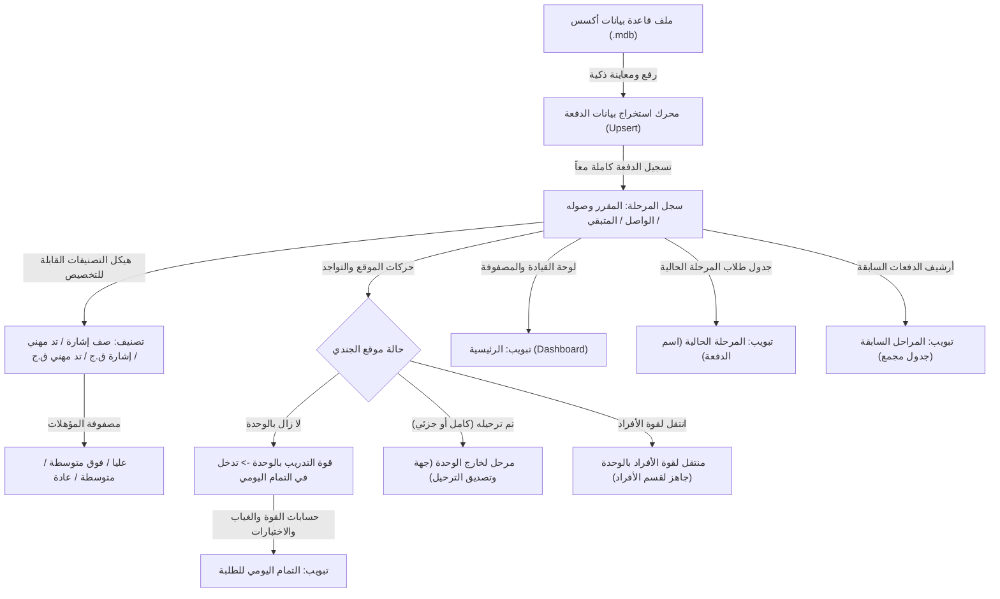

# 📄 وثيقة متطلبات ومواصفات المنتج — PRD
## منظومة الأرشيف وإدارة العمليات العسكرية (Elec-Archive)
### الإصدار: 2.3 | التاريخ: 5 نوفمبر 2026 | الحالة: معتمد ومطابق للواقع الفعلي (Verified & Approved)

---

## 1. نظرة عامة على المشروع (Project Overview & Strategic Context)

### 1.1 الرؤية والهدف (Vision & Objectives)
منظومة **Elec-Archive** هي منصة ويب عسكرية متكاملة ومؤمنة مخصصة لإدارة الأرشيف الإلكتروني، شئون الأفراد والضباط، ومتابعة العمليات اليومية في القيادة العسكرية. تهدف المنظومة إلى الاستغناء الكامل عن الدورة المستندية الورقية المعرضة للتلف أو الفقد، وتوفير بيئة رقمية محكمة للقيادة والسيطرة تجمع بين دقة الأرشفة والسرعة التشغيلية الفائقة لاتخاذ القرار.

### 1.2 البيئة التشغيلية (Operating Environment)
* **Offline-First / Intranet:** المنظومة مصممة لتعمل بنسبة 100% داخل شبكة محلية مغلقة بالكامل (Air-gapped Intranet) دون أي اتصال خارجي بالإنترنت.
* **البنية التحتية والاستضافة:** خادم محلي بنظام Linux أو Windows Server، يعمل بحاويات عزل محلية (App + MongoDB 7 Container + Nginx Proxy).
* **اللغة والاتجاه:** واجهة مستخدم عربية بالكامل مصممة أصلاً من اليمين لليسار (RTL-First).

### 1.3 الحزمة التقنية والمعمارية (Architecture Stack)
* **Frontend & Backend:** Next.js 16 (App Router + React 19) مع اعتماد صارم لسياسة **SSR-First** (React Server Components) والحد الأدنى من `'use client'`.
* **Database & ODM:** MongoDB 7 محلي عبر Mongoose 9.x.
* **Type Safety & Validation:** TypeScript 5.x Strict Mode (حظر تام لاستخدام `any`) + Zod 4 للتحقق من صحة المدخلات وطلبات الـ API.
* **الهوية البصرية ونظام التصميم:** نظام تصميم قياسي موحد يُعرف بـ **Sapphire Archive ("The Digital Monolith")**، موثق في الصفحة المرجعية `/theme-playground`، ويعتمد على الرموز اللونية (`--color-primary`, `--app-muted-foreground`) والمكونات المركزية القياسية (`MainTable`, `ModalShell`, `CustomSelect`, `DateField`, `FolderTabs`, `MonoBadge`).
* **الصلاحيات والأمان (RBAC & Audit):** 4 مستويات صلاحية رئيسية (`Admin` > `Commander` > `Employee` > `Viewer`) مع صلاحيات فرعية لكل موديول (`none` / `view` / `edit`)، وتوثيق إلزامي لجميع العمليات الحساسة في سجل التدقيق الموحد (`AuditLog`).

---

## 2. توثيق الوضع الراهن للمنظومة (Current Baseline Features)

يعمل النظام حالياً بـ 8 موديولات تشغيلية رئيسية:

```
┌─────────────────────────────────────────────────────────────────────────────┐
│                          Commander Dashboard (/dashboard)                   │
├──────────────┬──────────────┬──────────────┬──────────────┬─────────────────┤
│    الفاكس    │ شئون الضباط  │  أركان حرب   │ النقطة الطبية│   شئون الطلاب   │
│   الأرشيف    │  السجلات 121 │  القوة والمهام│ الصيدلية والملف│   (ترقية شاملة) │
│    (/fax)    │ (/officers)  │(/arkan-harb) │  (/medical)  │   (/students)   │
├──────────────┴──────────────┴──────────────┴──────────────┴─────────────────┤
│         جناح التعليم (/education) [مرحلة تجديد لاحقة - خارج النطاق حالياً]     │
├─────────────────────────────────────────────────────────────────────────────┤
│         إدارة النظام والحسابات (/admin)  •  سجل التدقيق والرقابة (/audit-log)    │
└─────────────────────────────────────────────────────────────────────────────┘
```

1. **لوحات القيادة التشغيلية المتقدمة (Operate Mode Dashboards):**
   * واجهات عالية الكثافة المعلوماتية وسريعة القراءة (Scanability) مزودة بأرقام مصفوفة (`tabular-nums`) لمنع اهتزاز الشاشات أثناء التحديث.
   * شريط المؤشرات القياسي (`OperateKpiStrip`) الموحد بدون ظلال مبتذلة، مع شارات الاتجاه والمقارنة، ومؤشر التقدم الدقيق.
   * الرسوم البيانية التفاعلية لتردد 7 أيام (`OperateTelemetryChart`)، وألواح التوزيع المتراصّة القابلة للنقر (`OperateDistributionPanel`) لفلترة الجداول فورياً.
2. **منظومة الفاكس والأرشيف الإلكتروني (`/fax`):**
   * تسجيل وأرشفة الفاكسات الواردة والصادرة مع دعم رفع ملفات PDF والصور.
   * تتبع المكاتبات المترابطة (Fax Threading)، وتدوين تأشيرات وتوجيهات القائد للأقسام.
3. **شئون الضباط (`/officers`):**
   * السجل العسكري الشامل، تتبع الأقدميات، الترقيات، وتاريخ الخدمة.
   * محرك فحص وقراءة نموذج 121 العسكري (`AcroForm 121 PDF Parser`) واستخراج البيانات آلياً.
   * عزل تام للضباط المنقولين أو المنتهية خدمتهم خارج الوحدة (`isInUnit: false`).
4. **فرع العمليات وأركان حرب (`/arkan-harb`):**
   * محرك التمام اليومي الميداني مع جداول مخصصة وقفل الحالات الطبية وحفظ المسودات محلياً (`localStorage`)، مع تطبيق قاعدة الإغلاق اليومي عند الساعة 18:00.
   * سجل المأموريات والتكليفات الفردية والجماعية مع خطوط السير وأوامر التحرك A4.
   * هيكل الوظائف وتسليم وتسلم المسؤوليات والضباط البدلاء (`PositionAssignment`).
   * سجل قرارات وتصديقات القائد على طلبات الإجازات (`CommanderDecisionsTab`).
   * جدول النوبتجيات والخدمات العسكرية ومحرك تبديل النوبتجيات الطارئة (Duty Swap).
5. **النقطة الطبية والصيدلية (`/medical`):**
   * إدارة مخزون الأدوية والتشغيلات وتنبيهات الصلاحية والنواقص، وسجل حركة المخزون (`InventoryLedger`).
   * سجل زيارات العيادة والكشف وتوثيق الراحات الطبية والتحويلات إلى المستشفيات العسكرية.
   * الملف الطبي التراكمي للمريض (`PatientMedicalRecord`) للحساسيات والأمراض المزمنة.
6. **شئون الطلاب والدارسين (`/students`) — [الترقية الحالية الشاملة]:**
   * **دورة تدفق وصول الدفعة:** تتبع ثلاثي الأبعاد يبدأ من **(المقرر وصوله)** ثم **(ما تم وصوله)** ثم **(المتبقي للوصول)**.
   * **مبدأ حفظ الدفعة كوحدة متكاملة:** تبقى الدفعة مسجلة بالكامل في مرحلتها في قاعدة البيانات مع حفظ تاريخها التجنيدي.
   * **هيكل التصنيفات التخصصية القابلة للتخصيص:** تقسيم طلاب الدفعة إلى تصنيفات (مثل: "صف إشارة"، "تد مهني"، "إشارة ق. ج"، "إشارة تد مهني ق. ج") مع إمكانية إضافة أو تعديل أو حذف أي تصنيف، وتحت كل تصنيف تندرج تفصيلة المؤهل الدراسي (عليا، فوق متوسطة، متوسطة، عادة).
   * **إدارة حركات الترحيل والنقل (تعديل مبدأ الشطب):** إمكانية مغادرة تصنيف بالكامل لخارج الوحدة، أو ترحيل بعض الجنود والإبقاء على البعض، أو نقل جنود لقوة أفراد الوحدة، مع بقاء الجندي مسجلاً ضمن مرحلته وتمييز موقعه وحالته (`لا زال بالوحدة` / `تم ترحيله` / `انتقل لقوة الأفراد في الوحدة`).
   * **واجهة التبويبات القياسية (`FolderTabs`):** الرئيسية (Dashboard)، التمام اليومي (للمتواجدين بالوحدة فقط)، المرحلة الحالية (اسم الدفعة المختارة ديناميكياً)، والمراحل السابقة (أرشيف الدفعات).
   * **محرك استخراج ملفات Access (`.mdb`):** قراءة سريعة لجدول `src_soldiers` و `gyabhabs` مع المعاينة والتحديث بنظام `Upsert`.
7. **جناح التعليم والدورات (`/education`):**
   * الوضع الحالي: تسجيل الدورات والمناهج والمشاركين (متروك دون تعديل لإعادة بنائه لاحقاً).
8. **إدارة النظام والرقابة العامة (`/admin` & `/audit-log`):**
   * إدارة المستخدمين والصلاحيات الهرمية، وهيكل الأفرع والأقسام، وسجل تدقيق شامل للعمليات.
   * محرك النسخ الاحتياطي الربع سنوي وتدوير النسخ التلقائي لحفظ أحدث 4 نسخ وحذف ما قبلها.

---

## 3. نطاق التطوير وحدود العمل (Scope & Guardrails)

### 3.1 داخل النطاق المعتمد (In-Scope)

#### أولاً: ترقية منظومة شئون الطلاب (`/students`) ودورة حياة الدفعة
1. **دورة تدفق ومتابعة وصول الدفعة (Batch Arrival Workflow):**
   - حصر **المقرر وصوله** (القوة المخطط استقبالها من مناطق التجنيد للدفعة).
   - حصر **ما تم وصوله** (القوة الفعلية التي وصلت واستلمتها الوحدة).
   - احتساب **المتبقي للوصول** تلقائياً ($\text{المتبقي} = \text{المقرر وصوله} - \text{ما تم وصوله}$) مع إمكانية استكمال الوافدين المتأخرين.
2. **منظومة التصنيفات التخصصية وتفصيل المؤهلات (Configurable Classification Matrix):**
   - تصنيف طلاب الدفعة الواحدة إلى فئات تخصصية معتمدة قابلة للتخصيص الكامل:
     * `صف إشارة`
     * `تد مهني`
     * `إشارة ق. ج`
     * `إشارة تد مهني ق. ج`
     * إمكانية إضافة تصنيفات جديدة، أو تعديل المسميات، أو حذف أي منها.
   - تفريع كل تصنيف تخصصي داخلياً حسب **المؤهل الدراسي**:
     * مؤهل عالي (عليا)
     * مؤهل فوق متوسط (فوق متوسطة)
     * مؤهل متوسط (متوسطة)
     * مؤهل عادي (عادة)
3. **حركات الترحيل والنقل وتعديل مبدأ الشطب (Relocation & Transfer Engine):**
   - **بقاء التسجيل الدائم:** الجندي يظل دائماً مسجلاً ومؤرشفاً ضمن مرحلته ودفعته الأصلية، ولا يُحذف سجله من الدفعة مطلقاً.
   - **تمييز حالة التواجد والموقع (`locationStatus`):**
     1. **لا زال بالوحدة (In Unit - Training):** جندي مستمر داخل الوحدة يخضع لبرنامج التدريب ويدخل في حسابات التمام اليومي للطلبة.
     2. **تم ترحيله (Relocated Outside Unit):** جندي تم ترحيله وتوزيعه خارج الوحدة (يدعم ترحيل تصنيف كامل دفعة واحدة، أو ترحيل أفراد محددين مع إبقاء الباقين بالوحدة) مع توثيق جهة وتاريخ الترحيل ورقم التصديق العسكري.
     3. **انتقل إلى قوة الأفراد في الوحدة (Transferred to Unit Personnel):** جندي تم تسكينه بشكل دائم كفرد من قوة الوحدة (يخرج من تمام الطلبة ويبقى بملف الدفعة تمهيداً لربطه بقسم الأفراد لاحقاً).
4. **محرك استخراج البيانات من ملفات Microsoft Access (`.mdb` Parser):**
   - استخراج بيانات الطلاب من جدول `src_soldiers` المعتمد (الرقم العسكري، الاسم، المرحلة `MRHLA`، الرقم القومي، الثلاثي، التواريخ، المؤهل، المحافظة، فصيلة الدم، وبيانات الطوارئ).
   - استخراج سجلات الغياب والحبس من جدول `gyabhabs`.
   - نافذة رفع ذكية مع معاينة سريعة (`Preview Modal`) تعرض إحصائيات الدفعات وأعداد الطلاب لتأكيد الاستيراد، مع تحديث السجلات (`Upsert`) بالرقم العسكري لمنع التكرار.
5. **محرك التمام اليومي لطلبة المرحلة (Student Daily Rollcall Engine):**
   - محرك تمام تفاعلي يحسب القوة اليومية لـ **المتواجدين بالوحدة فقط** (`locationStatus: "in_unit"`).
   - حالات التمام المعتمدة:
     * الموجود: حاضر (طابور / تدريب)، خدمة داخلية / نوبتجية، عيادة الوحدة.
     * الخوارج الرسمية: **اختبار كلية شرطة**، **اختبار الأكاديمية العسكرية**، **إجازة مرضي**، إجازة دورية/ميدانية، راحة طبية، حجز بمستشفى عسكري، ومأمورية خارجية.
     * الخوارج الانضباطية: غياب بدون إذن، حبس انضباطي / سجن حربي، ومحكمة / نيابة عسكرية.
6. **إعادة هيكلة واجهة الطلاب بتبويبات المجلد (`FolderTabs`):**
   - **التبويب 1: الرئيسية (Dashboard):** شريط تدفق وصول الدفعة (المقرر، الواصل، المتبقي، المتواجد بالوحدة، المرحل، المنتقل للأفراد)، ومصفوفة التصنيفات والمؤهلات التفاعلية، وتوزيع المحافظات وفصائل الدم.
   - **التبويب 2: التمام اليومي:** محرك حضور وانضباط يومي للمتواجدين بالوحدة مع كشف طباعة معتمد.
   - **التبويب 3: المرحلة الحالية (اسم الدفعة المختارة):** إمكانية اختيار المرحلة الحالية النشطة من قبل المستخدم مع اختيار الأحدث افتراضياً، وتغيير مسمى التبويب تلقائياً باسمها (مثال: "مرحلة 2024/1") مع جدول الطلاب الشامل وعمود تمييز الموقع.
   - **التبويب 4: المراحل السابقة (أرشيف الدفعات):** جدول مجمع لكافة طلاب المراحل السابقة دفعة واحدة مع عمود يوضح رقم الدفعة وحالة التواجد وحالة التسريح.

#### ثانياً: سياسة وحوكمة النسخ الاحتياطي الربع سنوي وتدوير النسخ
1. **النسخ الاحتياطي الآلي الربع سنوي (Quarterly Backup Automation):**
   - أتمتة تصدير نسخة احتياطية كل 3 أشهر (نهاية مارس، نهاية يونيو، نهاية سبتمبر، نهاية ديسمبر).
   - شمول كامل قاعدة بيانات MongoDB (`mongodump`) ومجلد المرفقات (`public/uploads`) بما فيه ملفات الـ `.mdb` في أرشيف مضغوط ومؤرخ.
2. **قاعدة تدوير وحفظ أحدث 4 نسخ (Retention of 4 Latest Backups):**
   - الاحتفاظ تلقائياً بأحدث 4 نسخ احتياطية فقط (تغطي عاماً تشغيلياً كاملاً).
   - الحذف الآلي التلقائي لأي نسخ أقدم لتوفير المساحة وتجنب امتلاء وحدات التخزين.
3. **التصدير الفوري من لوحة الإدارة (`/admin`):**
   - زر مخصص للمسؤول لتشغيل وتصدير نسخة احتياطية فورية على وسيط خارجي عند الطلب.

---

### 3.2 خارج النطاق صراحة (Explicit Out-of-Scope)
* **قسم شئون الأفراد والدرجات الأخرى المستقل (`/personnel`):** سيتم بناؤه وتفعيله في مرحلة تطويرية لاحقة ومستقلة؛ يقتصر النطاق الحالي على تصنيف الجنود المنتقلين لقوة الأفراد وإعداد بياناتهم للمزامنة التلقائية فور تفعيله.
* **جناح التعليم والدورات (`/education`):** يُترك كما هو دون تعديل في هذه المرحلة.
* **يومية الحوادث والعمليات الطارئة المنفصلة (Incident Log):** مستبعدة نهائياً ويُكتفى بسجل قرارات وتأشيرات الفاكس.
* **الاتصال الخارجي / السحابي:** حظر تام لأي خدمات سحابية أو إشعارات خارجية (SMS / SMTP / CDNs).

---

## 4. متطلبات الميزات والتطويرات بالتفصيل (Detailed Features)



---

### ميزة 1: محرك رفع ومعاينة واستخراج بيانات الطلبة من ملفات Access (.mdb)
* **المعرف:** `FEAT-STU-01`
* **الأولوية:** حرجة وعالية جداً (P1)
* **المستفيد:** ضابط شئون الطلاب، مدخل البيانات، قائد الجناح.

#### User Story:
> بصفتي ضابط شئون الطلاب، أريد رفع ملف قاعدة بيانات Access بصيغة `.mdb` لاستخراج بيانات الجنود والطلبة المستجدين وسجلات انضباطهم آلياً مع مراجعة ملخص الاستيراد قبل الحفظ، لتحديث المنظومة وتجنب الإدخال اليدوي.

#### المتطلبات الوظيفية:
* **FR-01.1 (دعم صيغة .mdb):** توفير مسار رفع آمن يقبل ملفات Microsoft Access ذات الامتداد `.mdb` مع فحص الامتداد والبنية.
* **FR-01.2 (استخراج جدول `src_soldiers`):** قراءة وتعيين الحقول العسكرية:
  - `MILITARY_NO`: الرقم العسكري (المفتاح الرئيسي لمنع التكرار).
  - `SOLDIER_NAME`: الاسم الرباعي للطلب/الجندي.
  - `MRHLA`: المرحلة التجنيدية / رقم الدفعة (مثل 20241، 20221).
  - `national_no`: الرقم القومي (14 رقماً).
  - `SOLASY_NO`: الرقم الثلاثي التجنيدي.
  - `BIRTH_DATE` & `TAGNEED_DATE` & `TASREH_DATE`: تواريخ الميلاد والتجنيد والتسريح.
  - `MOAHEL_CODE`: المؤهل الدراسي (عليا، متوسطة، فوق متوسطة، عادة).
  - `GOVERNORATE_FK` & `ADDRESS`: المحافظة والعنوان.
  - `BLOOD_TYPE`: فصيلة الدم.
  - `rel_name`, `rel_tel`, `rel_degree`: بيانات ولي الأمر والطوارئ.
* **FR-01.3 (استخراج جدول `gyabhabs`):** استخراج وقائع الغياب والحبس (رقم العسكري، تواريخ الغياب من/إلى، تواريخ الحبس من/إلى، والمدة الإجمالية) وربطها بملف الطالب.
* **FR-01.4 (نافذة المعاينة الذكية - Preview Modal):** قبل الحفظ النهائي، تظهر نافذة تعرض:
  - إجمالي عدد السجلات المستخرجة.
  - تفنيد السجلات حسب الدفعات المكتشفة (`MRHLA`).
  - عدد السجلات الجديدة مقابل السجلات التي سيتم تحديثها.
  - زر `[تأكيد الاستيراد والتحديث]` وزر `[إلغاء]`.
* **FR-01.5 (التحديث الذري - Upsert):** تنفيذ عملية الحفظ بنظام Upsert (تحديث الطالب إذا كان رقمه العسكري مسجلاً مسبقاً، أو إضافته كطالب جديد) لضمان عدم ازدواجية السجلات.

---

### ميزة 2: لوحة المؤشرات وتدفق وصول الدفعة (Students Operate Dashboard)
* **المعرف:** `FEAT-STU-02`
* **الأولوية:** عالية (P1)
* **المستفيد:** قائد الجناح، ضابط العمليات، ضابط شئون الطلاب.

#### User Story:
> بصفتي قائد الجناح، أريد لوحة مؤشرات قيادية سريعة تستعرض مسار تدفق وصول الدفعة (المقرر، الواصل، المتبقي)، ومصفوفة توزيع التصنيفات التخصصية والمؤهلات الدراسية، وحركات التواجد بالوحدة والترحيل بضغطة زر.

#### المتطلبات الوظيفية:
* **FR-02.1 (شريط تدفق وصول الدفعة والقوة `OperateKpiStrip`):**
  - عداد **المقرر وصوله**: إجمالي القوة المخططة للدفعة.
  - عداد **ما تم وصوله**: القوة المستلمة فعلياً بالوحدة.
  - عداد **المتبقي للوصول**: الفارق المتبقي للوصول ($\text{المقرر} - \text{الواصل}$).
  - عداد **المتواجدين بالوحدة (تحت التدريب)**: القوة الصافية الخاضعة للتدريب والتمام.
  - عداد **المرحلون لخارج الوحدة**: إجمالي من تم ترحيلهم وتوزيعهم.
  - عداد **المنتقلون لقوة الأفراد**: من تم تسكينهم على قوة الوحدة الدائمة.
* **FR-02.2 (مصفوفة التصنيفات والمؤهلات التفاعلية Matrix Panel):**
  - جدول مصفوفي ذكي يعرض كل تصنيف تخصصي (صف إشارة، تد مهني، إشارة ق.ج، إشارة تد مهني ق.ج) كصف، وأعمدة تمثل المؤهلات (عليا، فوق متوسطة، متوسطة، عادة) مع إجمالي كل تصنيف.
  - إمكانية النقر على أي خلية لفلترة قائمة الطلاب في جدول المرحلة الحالية مباشرة.
* **FR-02.3 (ألواح التوزيع التفاعلية الجغرافية والطبية `OperateDistributionPanel`):**
  - توزيع الطلاب حسب المحافظات ومراكز التجنيد.
  - توزيع الطلاب حسب فصائل الدم.

---

### ميزة 3: محرك التمام اليومي لطلبة المرحلة (Student Daily Rollcall Engine)
* **المعرف:** `FEAT-STU-03`
* **الأولوية:** حرجة وعالية جداً (P1)
* **المستفيد:** ضابط النوبتجية، ضابط شئون الطلاب، قائد السرايا.

#### User Story:
> بصفتي ضابط شئون الطلاب، أريد تسجيل تمام طلبة المرحلة الحالية يومياً للجنود المتواجدين بالوحدة فقط، مع دعم الحالات العسكرية الواقعية (خاصة اختبارات الكليات العسكرية وكلية الشرطة والإجازات المرضية)، لطباعة تقرير التمام المعتمد.

#### المتطلبات الوظيفية:
* **FR-03.1 (قصر التمام على المتواجدين بالوحدة):** محرك التمام يستدعي تلقائياً الطلاب الذين حالتهم `locationStatus: "in_unit"` فقط، ويستثني تماماً من تم ترحيلهم أو من انتقلوا لقوة الأفراد.
* **FR-03.2 (شجرة حالات التمام المعتمدة):**
  - **الموجود (داخل الوحدة):**
    * `present`: حاضر (طابور / تدريب).
    * `duty_service`: خدمة داخلية / نوبتجية وحراسة.
    * `clinic`: عيادة الوحدة للكشف.
  - **الخوارج الإدارية والطبية والاختبارات (خارج الوحدة - رسمي):**
    * `leave`: إجازة دورية / ميدانية.
    * `sick_leave`: إجازة مرضي (بتصديق طبي).
    * `rest`: راحة طبية مصدق بها.
    * `hospital`: حجز بمستشفى عسكري.
    * `police_academy_exam`: اختبار كلية شرطة (مع حقول توثيق تواريخ المأمورية).
    * `military_academy_exam`: اختبار الأكاديمية العسكرية والكليات العسكرية.
    * `mission`: مأمورية خارجية / فرقة تدريبية.
  - **الخوارج الانضباطية والقضائية:**
    * `absent`: غياب بدون إذن (مع حساب مدة الغياب).
    * `prison`: حبس انضباطي / سجن حربي.
    * `court`: محكمة عسكرية / نيابة.
* **FR-03.3 (التكامل مع سجل الغياب والحبس المستورد):** في حال وجود سجل غياب أو حبس وارد من ملف الـ `.mdb` يغطي تاريخ اليوم، يتم تعيين الحالة تلقائياً مع تنبيه بصري واضح.
* **FR-03.4 (طباعة تمام القوة الميداني):** نموذج طباعة رسمي A4 معتمد لتمام الطلبة مقسم إلى الموجود والخارج وموقع من قائد الجناح.

---

### ميزة 4: إدارة المرحلة الحالية النشطة والتصنيفات (Current Active Stage Tab)
* **المعرف:** `FEAT-STU-04`
* **الأولوية:** عالية (P1)
* **المستفيد:** كافة مستخدمي موديول الطلاب.

#### User Story:
> بصفتي مستخدماً للمنظومة، أريد أن يظهر التبويب الثالث باسم المرحلة الحالية المحددة (مثل: "مرحلة 2024/1") مع بقاء الدفعة كاملة مسجلة معاً، وتمييز من لا زال بالوحدة أو تم ترحيله أو انتقل للأفراد، مع إمكانية الفلترة السريعة بالتصنيفات والمؤهلات.

#### المتطلبات الوظيفية:
* **FR-04.1 (تسمية التبويب الديناميكية):** يتغير عنوان التبويب الثالث في `FolderTabs` آلياً ليعكس مسمى المرحلة المختارة حالياً (مثال: `[ مرحلة 2024/1 ]`).
* **FR-04.2 (التعيين الافتراضي الذكي):** عند فتح الصفحة لأول مرة، يختار النظام تلقائياً أحدث مرحلة تجنيدية كـ "المرحلة الحالية".
* **FR-04.3 (قائمة الاختيار والتبديل وإعداد المقرر):** توفير شريط تحكم أعلى الجدول يتيح:
  - التبديل بين المراحل.
  - تعديل رقم "المقرر وصوله" للدفعة.
  - عرض عدادات التدفق (المقرر، الواصل، المتبقي).
* **FR-04.4 (جدول طلاب المرحلة الشامل `MainTable`):** يتضمن الأعمدة:
  - (م، الرقم العسكري، الاسم، الرقم القومي، الثلاثي، التصنيف التخصصي، المؤهل، المحافظة، فصيلة الدم).
  - عامود **حالة وموقع الجندي**: شارة هوياتية واضحة (`لا زال بالوحدة` باللون الكحلي القياسي / `تم ترحيله` / `انتقل لقوة الأفراد`).
  - عامود الإجراءات (تعديل، ترحيل، نقل للأفراد).
* **FR-04.5 (شريط فلاتر التصنيف والمؤهل):** فلترة فورية بالقائمة المنسدلة للتصنيفات التخصصية والمؤهلات الدراسية وحالة التواجد.

---

### ميزة 5: أرشيف المراحل السابقة والمتبقين (Archived Previous Stages Tab)
* **المعرف:** `FEAT-STU-05`
* **الأولوية:** متوسطة وعالية (P2)
* **المستفيد:** ضابط شئون الطلاب، الأرشيف العسكري.

#### User Story:
> بصفتي ضابط شئون الطلاب، أريد استعراض جدول مجمع يضم كافة طلاب المراحل السابقة دفعة واحدة، مع إبراز رقم الدفعة والتصنيف التخصصي وحالة التسريح وتحديد الجنود المتبقين.

#### المتطلبات الوظيفية:
* **FR-05.1 (الجدول المجمع الشامل):** عرض جدول واحد موحد يضم كافة طلاب المراحل السابقة (غير المرحلة الحالية المختارة) مع دعم التصفح والتقسيم لصفحات (`Pagination`).
* **FR-05.2 (أعمدة التمييز الإلزامية):**
  - عامود **رقم الدفعة / المرحلة (`MRHLA`)**.
  - عامود **التصنيف التخصصي والمؤهل**.
  - عامود **حالة التواجد** (مستمر بالوحدة، مرحل، منضم للأفراد).
  - عامود **حالة التسريح وتاريخه**.
* **FR-05.3 (فلترة سريعة للجنود المتبقين):** فلتر بنقرة واحدة لعزل "الجنود المتبقين" الذين تجاوز تاريخ تسريحهم التاريخ الحالي وما زالوا على قوة الوحدة لأسباب انضباطية أو طبية.

---

### ميزة 6: محرك تخصيص التصنيفات وحركات الترحيل والنقل (Classification & Relocation Engine)
* **المعرف:** `FEAT-STU-06`
* **الأولوية:** حرجة وعالية جداً (P1)
* **المستفيد:** ضابط شئون الطلاب، قيادة الوحدة.

#### User Story:
> بصفتي ضابط شئون الطلاب، أريد إدارة وتخصيص التصنيفات التخصصية بحرية (إضافة وحذف وتعديل)، مع القدرة على ترحيل تصنيف كامل أو مجموعة جنود لخارج الوحدة، أو نقل جنود لقوة الأفراد، مع بقاء كافة الجنود مسجلين ضمن دفعتهم الأصلية دون أي حذف.

#### المتطلبات الوظيفية:
* **FR-06.1 (إدارة وتخصيص التصنيفات - Classification Management):**
  - نافذة إدارة التصنيفات تتيح لضابط الشئون:
    * إضافة تصنيف جديد (مثل: "سائقين", "إشارة أسلحة مشتركة").
    * تعديل مسمى تصنيف قائم.
    * حذف تصنيف (مع التحقق من عدم وجود جنود مسكنين عليه أو إعادة تسكينهم).
    * التصنيفات الافتراضية الأولية: (`صف إشارة`، `تد مهني`، `إشارة ق. ج`، `إشارة تد مهني ق. ج`).
* **FR-06.2 (إجراء ترحيل التصنيفات لخارج الوحدة - Relocation):**
  - **ترحيل جماعي لتصنيف كامل:** إمكانية اختيار تصنيف تخصصي بالكامل وترحيله دفعة واحدة لخارج الوحدة (مثال: ترحيل كافة جنود "تد مهني").
  - **ترحيل جزئي / فردي:** ترحيل جنود محددين من التصنيف وترك باقي الجنود بالوحدة.
  - **بيانات الترحيل الموثقة:** نافذة الترحيل تسجل: (جهة الترحيل / الوحدة المستقبلة، تاريخ الترحيل، رقم وتاريخ أمر وتصديق الترحيل، سبب الترحيل).
  - **حالة الجندي:** تتغير إلى `locationStatus: "relocated"` مع استمراره مسجلاً ضمن دفعته.
* **FR-06.3 (إجراء النقل إلى قوة الأفراد بالوحدة - Transfer to Unit Personnel):**
  - زر وإجراء `[نقل لقوة الأفراد بالوحدة]` لنقل جنود محددين ليصبحوا على قوة الوحدة الدائمة.
  - توثيق تاريخ النقل، رقم أمر التعيين/التسكين، والوظيفة المسندة إليه بالوحدة.
  - تتغير حالة الجندي إلى `locationStatus: "transferred_to_unit_personnel"` ويتم استبعاده من تمام تدريب الطلبة وتجهيز بياناته لقسم الأفراد لاحقاً.
* **FR-06.4 (بقاء السجل والتاريخ):** يحظر النظام حذف الجندي من المرحلة؛ حيث تظل إحصائيات الدفعة محتفظة بكامل القوة الواصلة مع إيضاح المتواجدين بالوحدة، المرحلين، والمنتقلين للأفراد.

---

### ميزة 7: النسخ الاحتياطي الربع سنوي وتدوير النسخ (Quarterly Backup & Retention Policy)
* **المعرف:** `FEAT-SYS-01`
* **الأولوية:** حرجة (P1)
* **المستفيد:** مدير النظام (Admin)، قيادة المنظومة.

#### User Story:
> بصفتي مدير النظام، أريد أتمتة النسخ الاحتياطي لقاعدة البيانات والمرفقات كل ربع سنة مع الاحتفاظ تلقائياً بأحدث 4 نسخ وحذف ما قبلها، وتوفير زر للتصدير الفوري عند الحاجة، لضمان استمرارية العمل ومنع فقدان البيانات.

#### المتطلبات الوظيفية:
* **FR-07.1 (دورية النسخ الآلي الربع سنوي):** جدولة عملية نسخ احتياطي شاملة كل ربع سنة (31 مارس، 30 يونيو، 30 سبتمبر، 31 ديسمبر).
* **FR-07.2 (محتوى النسخة الاحتياطية):**
  - تفريغ كامل لقاعدة بيانات MongoDB عبر أداة `mongodump`.
  - أرشفة كامل محتويات مجلد المرفقات (`public/uploads`) شاملاً ملفات الـ `.mdb` ونماذج 121 والمستندات.
  - ضغط النسخة في أرشيف واحد بصيغة `.tar.gz` يحمل طابعاً زمنياً موحداً (مثال: `backup-q1-2026-20260331.tar.gz`).
* **FR-07.3 (قاعدة الاحتفاظ الصارمة - أحدث 4 نسخ فقط):**
  - يحتفظ النظام بحد أقصى بـ **أحدث 4 نسخ احتياطية** (تغطي عاماً تقويمياً كاملاً).
  - بعد اكتمال كل نسخة احتياطية جديدة بنجاح، يقوم المحرك بفحص مجلد النسخ الاحتياطية وحذف النسخ الأقدم تلقائياً التي تتجاوز النسخ الأربع الأخيرة، مع تسجيل إشعار بنتيجة الحذف في سجل التدقيق `AuditLog`.
* **FR-07.4 (التصدير اليدوي الفوري من لوحة التحكم):** توفير زر `[تصدير نسخة احتياطية فورية]` في صفحة إدارة النظام (`/admin`) لتوليد وتحميل النسخة المضغوطة مباشرة على وحدة تخزين خارجية معزولة (Flash Drive / External SSD).

---

## 5. الملاحظات المعمارية وخريطة الـ APIs والأمان (Architecture & APIs)

### 5.1 تعديلات وتوسعات نماذج قاعدة البيانات (Database Schema Updates)

#### 1. موديل المرحلة والتدفق والتصنيفات `StudentBatch.ts`:
* **المسار:** `next/lib/db/models/StudentBatch.ts`
```typescript
export interface IBatchClassification {
  id: string;                  // معرف التصنيف الفريد (slug / uuid)
  name: string;                // مسمى التصنيف بالعربية (صف إشارة، تد مهني، إشارة ق. ج، إلخ)
  description?: string;
  isDefault?: boolean;
}

export interface IStudentBatch extends Document {
  mrhla: string;               // كود الدفعة / المرحلة التجنيدية (e.g. "20241")
  name: string;                // الاسم المعروض (e.g. "مرحلة 2024/1")
  targetCount: number;         // المقرر وصوله
  arrivedCount: number;        // ما تم وصوله فعلياً
  remainingCount: number;      // المتبقي للوصول (محسوب)
  isActiveStage: boolean;      // هل هي المرحلة الحالية المختارة
  classifications: IBatchClassification[]; // التصنيفات التخصصية المعتمدة للدفعة
  startDate?: Date;
  endDate?: Date;
  createdAt: Date;
  updatedAt: Date;
}
```

#### 2. ترقية موديل الطالب `Student.ts`:
* **المسار:** `next/lib/db/models/Student.ts`
```typescript
export type StudentStatus = "active" | "graduated" | "inactive" | "withdrawn";
export type QualificationType = "high" | "above_avg" | "average" | "normal";
export type StudentLocationStatus = "in_unit" | "relocated" | "transferred_to_unit_personnel";

export interface IStudent extends Document {
  militaryNo: string;           // الرقم العسكري (المفتاح الرئيسي الفريد)
  fullName: string;             // الاسم الرباعي
  mrhla: string;                // المرحلة التجنيدية / رقم الدفعة (e.g. "20241")
  nationalNo?: string;          // الرقم القومي (14 رقم)
  solasyNo?: string;            // الرقم الثلاثي التجنيدي
  birthDate?: Date;             // تاريخ الميلاد
  tagneedDate?: Date;           // تاريخ التجنيد
  tasrehDate?: Date;            // تاريخ التسريح المخطط
  
  // التصنيف التخصصي والمؤهل
  classificationId?: string;    // معرف التصنيف التخصصي
  classificationName?: string;  // مسمى التصنيف (صف إشارة، تد مهني، إشارة ق. ج، ...)
  qualification?: QualificationType; // المؤهل (عليا، فوق متوسطة، متوسطة، عادة)
  qualificationName?: string;   // مسمى المؤهل بالعربية
  
  // التواجد والموقع وحركات المغادرة
  locationStatus: StudentLocationStatus; // لا زال بالوحدة | تم ترحيله | انتقل للأفراد
  
  // تفاصيل الترحيل لخارج الوحدة
  relocationDetails?: {
    destination: string;        // جهة الترحيل / الوحدة المنقول إليها
    date: Date;                 // تاريخ الترحيل
    orderNo: string;            // رقم وتاريخ أمر وتصديق الترحيل
    reason?: string;            // سبب الترحيل
  };

  // تفاصيل النقل لقوة الأفراد بالوحدة
  unitPersonnelDetails?: {
    transferDate: Date;         // تاريخ النقل لقوة الأفراد
    orderNo: string;            // رقم أمر التسكين والتصديق
    assignedRole?: string;      // الوظيفة المسندة بالوحدة
  };

  governorate?: string;         // المحافظة
  address?: string;             // العنوان التفصيلي
  bloodType?: string;           // فصيلة الدم
  status: StudentStatus;        // الحالة العامة
  dischargeStatus?: "on_time" | "delayed_remaining" | "exempt" | "other";

  // سجل الطوارئ والاتصال
  guardianName?: string;
  guardianRelation?: string;
  guardianPhone?: string;

  // سجلات الغياب والحبس المستوردة من MDB
  disciplinaryRecords?: Array<{
    type: "absence" | "detention";
    startDate: Date;
    endDate?: Date;
    totalDays: number;
    source: "mdb_import" | "manual";
  }>;

  createdAt: Date;
  updatedAt: Date;
}
```

#### 3. موديل التمام اليومي لطلبة المرحلة `StudentRollcall.ts`:
```typescript
export interface IStudentRollcallEntry {
  studentId: Types.ObjectId;
  militaryNo: string;
  fullName: string;
  classificationName?: string;
  qualification?: QualificationType;
  status: 
    | "present" 
    | "duty_service" 
    | "clinic" 
    | "leave" 
    | "sick_leave" 
    | "rest" 
    | "hospital" 
    | "police_academy_exam" 
    | "military_academy_exam" 
    | "mission" 
    | "absent" 
    | "prison" 
    | "court";
  notes?: string;
  destination?: string; // جهة المستشفى أو جهة الاختبار أو المأمورية
  expectedReturnDate?: Date;
}

export interface IStudentRollcall extends Document {
  date: Date;
  mrhla: string;                // تمام المرحلة المستهدفة
  inUnitTotalStrength: number;  // القوة المتواجدة بالوحدة فقط
  presentCount: number;
  outCount: number;
  entries: IStudentRollcallEntry[];
  recordedBy: Types.ObjectId;
  createdAt: Date;
}
```

---

### 5.2 خريطة مسارات الـ APIs المعتمدة (Verified API Endpoints Map)

| المسار | الطريقة | الوصف | الصلاحية المطلوبة |
| :--- | :---: | :--- | :--- |
| `/api/students/upload-mdb` | `POST` | رفع وتحليل ملف `.mdb` واستخراج إحصائيات المعاينة للدفعة | `students: edit` |
| `/api/students/import-confirm` | `POST` | تأكيد استيراد وحفظ/تحديث بيانات الطلاب من ملف `.mdb` بنظام Upsert | `students: edit` |
| `/api/students/stages` | `GET` | قائمة المراحل المسجلة مع إحصائيات التدفق (المقرر، الواصل، المتبقي) | `students: view` |
| `/api/students/stages/[id]/target` | `PATCH` | تحديث رقم القوة المقرر وصولها للدفعة | `students: edit` |
| `/api/students/stages/[id]/classifications` | `POST / PUT / DELETE` | إدارة وتخصيص التصنيفات التخصصية للدفعة (إضافة، تعديل، حذف) | `students: edit` |
| `/api/students/active-stage` | `POST` | تعيين مرحلة معينة كـ "المرحلة الحالية" النشطة للمنظومة | `students: edit` |
| `/api/students/relocate` | `POST` | ترحيل جماعي لتصنيف كامل أو ترحيل جنود محددين لخارج الوحدة | `students: edit` |
| `/api/students/transfer-personnel` | `POST` | نقل جنود محددين من الدفعة إلى قوة الأفراد بالوحدة | `students: edit` |
| `/api/students/rollcall` | `GET / POST` | استعلام وحفظ التمام اليومي لطلبة المرحلة (للمتواجدين بالوحدة فقط) | `students: edit` |
| `/api/admin/backup/quarterly` | `POST` | تشغيل النسخ الاحتياطي وتطبيق سياسة الاحتفاظ بأحدث 4 نسخ | `Admin` |
| `/api/admin/backup/download` | `GET` | تحميل النسخة الاحتياطية الفورية المضغوطة | `Admin` |

---

### 5.3 قواعد الأمان وحوكمة التشغيل واستمرارية العمل (Security & Continuity)

1. **تسجيل التدقيق الإلزامي (`AuditLog`):**
   * كل عملية رفع ملف `.mdb`، ترحيل تصنيف، نقل للأفراد، تسجيل تمام، أو تصدير نسخة احتياطية تسجل في `AuditLog` مع اسم المستخدم والتوقيت الدقيق والمعرفات المعنية.
2. **حوكمة النسخ الاحتياطي الربع سنوي (Quarterly Backup Governance):**
   * دورية النسخ: نهاية مارس، يونيو، سبتمبر، ديسمبر.
   * سياسة الحفظ الصارم: الاحتفاظ بأحدث **4 نسخ احتياطية فقط**، مع الحذف الآلي الممنهج لما دونها لحماية وسائط التخزين من الامتلاء.
3. **أمن الجلسات والخمول العسكري (Session Security):**
   * قفل الشاشات تلقائياً عند انقضاء مهلة عدم النشاط (Inactivity Timeout).

---

## 6. مراحل التنفيذ والإنجاز (Implementation Status)

```
┌────────────────────────────────────────────────────────────────────────┐
│ Phase 1: الأساس المعماري وتكامل الموديولات (COMPLETED)                 │
│ • ربط الفاكس بالمأموريات (تحويل فوري + فتح المرفق)                      │
│ • ربط النقطة الطبية بمحرك التمام (الراحات وحجز المستشفيات)             │
│ • ربط مسمى الوظيفة وسجل المأموريات في شئون الضباط                      │
├────────────────────────────────────────────────────────────────────────┤
│ Phase 2: أوامر التحرك والتحقق الاستباقي (COMPLETED)                    │
│ • نموذج طباعة أمر التحرك العسكري الموحد A4 للمأموريات الفردية والجماعية │
│ • فحص التعارضات الاستباقي داخل النوافذ التفاعلية                       │
│ • رفع مستندات إخلاء الطرف وإنجاز المأمورية حتى 10MB عبر PATCH          │
├────────────────────────────────────────────────────────────────────────┤
│ Phase 3: منظومة النوبتجيات والتبديل الطارئ (COMPLETED)                 │
│ • موديل وشاشات جدول النوبتجيات والخدمات مع عدالة التوزيع               │
│ • محرك تبديل النوبتجيات الطارئة وسجل تاريخ التبديلات (Duty Swap)       │
│ • ربط نوبتجي اليوم بالتمام الميداني وقاعدة الإغلاق اليومي عند 18:00    │
├────────────────────────────────────────────────────────────────────────┤
│ Phase 4: ترقية شئون الطلاب ودورة حياة الدفعة والنسخ الربع سنوي (CURRENT TRACK) │
│ • موديل الدفعة وتدفق الوصول (المقرر وصوله / ما تم وصوله / المتبقي)     │
│ • مصفوفة التصنيفات التخصصية القابلة للتخصيص وتفريع المؤهلات الدراسية   │
│ • محرك ترحيل التصنيفات (كامل/جزئي) والنقل لقوة الأفراد مع بقاء التسجيل │
│ • رفع وتحليل ملفات Access .mdb مع نافذة المعاينة والتحديث بنظام Upsert │
│ • تبويبات FolderTabs (الرئيسية، التمام، المرحلة الحالية، المراحل السابقة)│
│ • محرك التمام اليومي للمتواجدين بالوحدة (اختبارات، عيادة، إجازة مرضي)  │
│ • أتمتة النسخ الاحتياطي الربع سنوي وتدوير النسخ (حفظ أحدث 4 نسخ فقط)  │
└────────────────────────────────────────────────────────────────────────┘
```

---

## 7. خلاصة القرار الفني (Sign-off & Conclusion)
بهذا التوصيف المنقح في الإصدار 2.3، تم ترسيخ النموذج العسكري الواقعي للتعامل مع الدفعة كوحدة متكاملة: تتبع مسار تدفق الوصول (المقرر، الواصل، المتبقي)، تصنيف الطلاب تخصصياً ومؤهلاتياً مع مرونة كاملة في التخصيص، وتوثيق حركات الترحيل خارج الوحدة أو التسكين على قوة أفراد الوحدة مع بقاء سجل الجندي محفوظاً بشكل دائم ومؤرشف ضمن مرحلته ودفعته، فضلاً عن إحكام التمام اليومي للمتواجدين فعلياً بالوحدة، وتفعيل سياسة النسخ الاحتياطي الربع سنوي مع الاحتفاظ بأحدث 4 نسخ فقط لضمان سلامة واستمرارية النظام.
