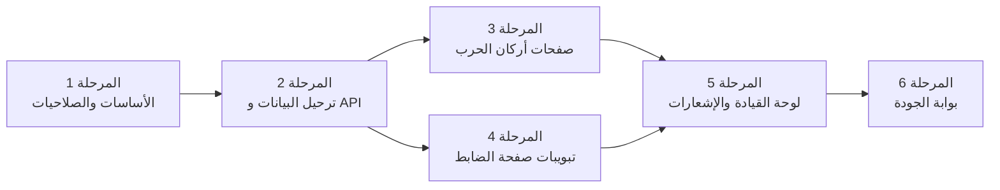

# خارطة الطريق — فرع أركان الحرب (009-arkan-harb)

**التاريخ**: 2026-04-10  
**المصدر**: `docs/aide/vision.md`  
**عدد المراحل**: 6  
**النطاق الزمني المُقدَّر لكل مرحلة**: ~أسبوع واحد

---

## المرحلة 1: الأساسات والصلاحيات (Foundation & Permissions)

### الهدف

بناء طبقة البيانات الجديدة بالكامل (Models + Schemas + Permissions) بدون لمس أي واجهة مستخدم. بنهاية هذه المرحلة، يمكن للمطور كتابة كود يستخدم الموديلات الجديدة ونظام الصلاحيات فوراً.

### المخرجات

- **موديل `PositionAssignment`** — ملف `next/lib/db/models/PositionAssignment.ts`
  - الحقول: `officerId`, `positionTitle`, `positionType` (`primary` | `substitute`), `substituteForOfficerId?`, `startDate`, `endDate?`, `orderNumber?`, `notes?`, `status` (`active` | `ended`), `createdBy`
  - Index على `officerId + startDate` و `status`
  - Validation: `endDate >= startDate`، ومنع `substituteForOfficerId` إذا `positionType === "primary"`

- **موديل `Promotion`** — ملف `next/lib/db/models/Promotion.ts`
  - الحقول: `officerId`, `fromRank` (OfficerRank enum), `toRank` (OfficerRank enum), `effectiveDate`, `orderNumber?`, `notes?`, `createdBy`
  - Index على `officerId + effectiveDate`
  - Validation: `toRank !== fromRank`

- **موديل `Mission`** — ملف `next/lib/db/models/Mission.ts`
  - الحقول: `officerId`, `title`, `description?`, `destination?`, `startDate`, `endDate?`, `status` (`scheduled` | `active` | `completed` | `cancelled`), `createdBy`, `updatedBy`
  - Index على `officerId + startDate` و `status`
  - Validation: `endDate >= startDate`

- **تحديث `next/lib/db/models/index.ts`** — تصدير الموديلات الثلاثة الجديدة

- **تسجيل صلاحية `arkan_harb`** — تحديث الملفات التالية:
  - `next/lib/db/models/User.ts`: إضافة `arkan_harb: ModulePermission` للـ `permissions`
  - `next/lib/auth/types.ts`: إضافة `arkan_harb` لنوع `ModulePermissions`
  - `next/lib/validations/auth.ts` (أو ملف schemas المقابل): إضافة `arkan_harb` للـ Zod schema

- **Zod Schemas جديدة** — ملف `next/lib/validations/arkan-harb.ts`
  - `createMissionSchema`, `updateMissionSchema`
  - `createPromotionSchema`, `updatePromotionSchema`
  - `createPositionAssignmentSchema`, `updatePositionAssignmentSchema`

### التبعيات

لا تبعيات — هذه المرحلة مستقلة.

### معايير القبول

- [ ] `npm run build` يمر بنجاح بعد إضافة الموديلات والصلاحيات
- [ ] `npm run lint` بدون تحذيرات جديدة
- [ ] الموديلات الثلاثة تُصدَّر من `index.ts` بشكل صحيح
- [ ] Zod schemas تغطي جميع عمليات Create/Update للموديلات الثلاثة
- [ ] صلاحية `arkan_harb` مسجلة في نظام المصادقة وتظهر عند إنشاء/تعديل مستخدم من لوحة الإدارة
- [ ] لا أي تغيير في سلوك النظام الحالي (لم نضف واجهات أو routes بعد)

---

## المرحلة 2: ترحيل البيانات و API الأساسية (Data Migration & API Core)

### الهدف

ترحيل البيانات الحالية من موديل `Assignment` إلى الموديلات الثلاثة الجديدة، وبناء جميع الـ API routes لأركان الحرب. بنهاية هذه المرحلة، يمكن اختبار كل CRUD operation عبر أداة مثل `curl` أو Postman.

### المخرجات

- **سكريبت الترحيل** — ملف `next/scripts/migrate-assignments.ts`
  - يقرأ جميع سجلات `Assignment` من MongoDB
  - `type === "promotion"` → يُنشئ سجل `Promotion` مع ملء `fromRank`/`toRank` من `title` (أو يُترك فارغاً مع warning)
  - `type === "mission"` → يُنشئ سجل `Mission`
  - `type === "assignment"` → يُنشئ سجل `PositionAssignment` (كتعيين أساسي)
  - يطبع تقرير الترحيل: عدد السجلات المُرحَّلة لكل نوع، الأخطاء (إن وُجدت)
  - **لا يحذف** سجلات `Assignment` الأصلية — تبقى كنسخة احتياطية
  - يدعم `--dry-run` flag لمعاينة التغييرات بدون كتابة

- **API Routes — المأموريات** تحت `next/app/api/arkan-harb/missions/`
  - `route.ts`: `GET` (قائمة + فلترة بـ officerId/status) + `POST` (إنشاء)
  - `[id]/route.ts`: `PATCH` (تحديث) — لا حذف فعلي
  - كل route يتبع: `auth → rate-limit → RBAC (arkan_harb: edit) → Zod → DB → audit → response`

- **API Routes — الترقيات** تحت `next/app/api/arkan-harb/promotions/`
  - `route.ts`: `GET` (قائمة + فلترة) + `POST` (إنشاء)
  - `[id]/route.ts`: `PATCH` (تحديث)
  - ملاحظة: POST يقبل أيضاً `officers: edit` (الترقيات تُدار من شئون الضباط أيضاً)

- **API Routes — التعيينات الوظيفية** تحت `next/app/api/arkan-harb/positions/`
  - `route.ts`: `GET` (قائمة + فلترة بـ officerId/status) + `POST` (إنشاء)
  - `[id]/route.ts`: `PATCH` (تحديث) + `DELETE` (حذف)
  - Validation: منع إنشاء تعيين أساسي إذا كان يوجد تعيين أساسي نشط على نفس `positionTitle` لضابط آخر (تحذير لا منع)

- **API Routes — إعادة توجيه** (Backwards Compatibility)
  - `next/app/api/arkan-harb/rollcall/route.ts`: يعيد التوجيه إلى `/api/officers/rollcall`، أو يُعيد استخدام نفس المنطق
  - `next/app/api/arkan-harb/leaves/route.ts`: يعيد التوجيه أو يشارك المنطق مع `/api/officers/leaves`
  - `next/app/api/arkan-harb/leaves/[id]/route.ts`: نفس النمط

### التبعيات

- **يعتمد على المرحلة 1** (الموديلات + الصلاحيات + Zod schemas)

### معايير القبول

- [ ] سكريبت الترحيل `--dry-run` يعمل بدون أخطاء ويطبع تقرير صحيح
- [ ] سكريبت الترحيل ينقل جميع سجلات `Assignment` إلى الموديلات الثلاثة بنجاح
- [ ] `POST /api/arkan-harb/missions` يُنشئ مأمورية جديدة ويُرجع `201`
- [ ] `GET /api/arkan-harb/missions?officerId=X` يُرجع مأموريات الضابط المحدد
- [ ] `POST /api/arkan-harb/positions` يُنشئ تعيين وظيفي ويُرجع `201`
- [ ] `POST /api/arkan-harb/promotions` يُنشئ ترقية ويُرجع `201`
- [ ] API routes ترفض الطلبات بدون مصادقة (401) وبدون صلاحية (403)
- [ ] Audit log يُسجَّل لكل عملية كتابة
- [ ] لا كسر في API routes الحالية (`/api/officers/*`)
- [ ] `npm run build` و `npm run lint` يمران بنجاح

---

## المرحلة 3: صفحات أركان الحرب (Staff Operations Pages)

### الهدف

بناء جميع صفحات الواجهة الأمامية لوحدة أركان الحرب، مع نقل صفحتي التمام والإجازات وإنشاء صفحتي المأموريات والتعيينات الوظيفية. بنهاية هذه المرحلة، يستطيع المستخدم التنقل في واجهة أركان الحرب بالكامل.

### المخرجات

- **نقل التمام اليومي** — `next/app/(dashboard)/arkan-harb/rollcall/page.tsx`
  - يستخدم مكون `RollcallSheet.tsx` الموجود (نقل أو استيراد مشترك من `components/officers/`)
  - يستخدم `RollcallSummary.tsx` للعرض للقائد
  - حفظ مسودة Local Storage Recovery يعمل كما هو

- **نقل الإجازات** — `next/app/(dashboard)/arkan-harb/leaves/page.tsx`
  - يستخدم مكون `LeaveRegister.tsx` الموجود (نقل أو استيراد مشترك)
  - يستخدم `LeaveAddModal.tsx` لإنشاء إجازة جديدة
  - فلترة بالضابط والنوع والحالة

- **إعادة التوجيه من المسارات القديمة**:
  - `next/app/(dashboard)/officers/rollcall/page.tsx` → redirect إلى `/arkan-harb/rollcall`
  - `next/app/(dashboard)/officers/leaves/page.tsx` → redirect إلى `/arkan-harb/leaves`
  - استخدام `redirect()` من `next/navigation` (server-side redirect)

- **صفحة المأموريات** — `next/app/(dashboard)/arkan-harb/missions/page.tsx`
  - مكون جديد `components/arkan-harb/MissionsTable.tsx`: جدول المأموريات مع فلترة وبحث
  - مكون جديد `components/arkan-harb/MissionForm.tsx`: نموذج إضافة/تعديل (Modal)
  - عرض الحالة بألوان مميزة (scheduled=أزرق، active=أخضر، completed=رمادي، cancelled=أحمر)

- **صفحة التعيينات الوظيفية** — `next/app/(dashboard)/arkan-harb/positions/page.tsx`
  - مكون جديد `components/arkan-harb/PositionAssignmentTable.tsx`: جدول التعيينات
  - مكون جديد `components/arkan-harb/PositionAssignmentForm.tsx`: نموذج إضافة/تعديل (Modal)
  - تمييز الأساسي عن البديل بلون مختلف
  - عرض اسم الضابط المُبدَل في حالة `substitute`
  - فلترة بالحالة (`active`/`ended`) وبالضابط

- **نقل/مشاركة مكونات إنشاء الترقية**:
  - نقل أو استيراد `OfficerPromoteModal.tsx` ليعمل مع موديل `Promotion` الجديد بدلاً من `Assignment`
  - تحديث المكون ليكتب إلى `POST /api/arkan-harb/promotions` بدلاً من `POST /api/officers/assignments`

### التبعيات

- **يعتمد على المرحلة 2** (API routes جاهزة)

### معايير القبول

- [ ] `/arkan-harb/rollcall` يعرض التمام اليومي بشكل كامل
- [ ] `/arkan-harb/leaves` يعرض الإجازات مع إمكانية الإضافة والفلترة
- [ ] `/officers/rollcall` يُعيد التوجيه تلقائياً إلى `/arkan-harb/rollcall`
- [ ] `/officers/leaves` يُعيد التوجيه تلقائياً إلى `/arkan-harb/leaves`
- [ ] `/arkan-harb/missions` يعرض ويُنشئ ويُعدل المأموريات
- [ ] `/arkan-harb/positions` يعرض ويُنشئ ويُعدل التعيينات الوظيفية
- [ ] جميع الصفحات RTL + Arabic + Design System
- [ ] جميع الصفحات SSR (لا `'use client'` إلا للمكونات التفاعلية)
- [ ] `npm run build` و `npm run lint` يمران بنجاح

---

## المرحلة 4: تبويبات صفحة تفاصيل الضابط (Officer Detail Tabs)

### الهدف

تحويل صفحة تفاصيل الضابط الحالية (`/officers/[id]`) من عرض خطي إلى عرض بتبويبات مع إضافة تبويبتي السجل المهني والسجل الوظيفي. بنهاية هذه المرحلة، تُعرض صفحة الضابط بشكل مُهيكل بأربع تبويبات.

### المخرجات

- **مكون التبويبات** — `next/components/officers/OfficerDetailTabs.tsx`
  - `'use client'` leaf component
  - أربع تبويبات: البيانات الأساسية | سجل الإجازات | السجل المهني | السجل الوظيفي
  - حفظ التبويبة النشطة في URL query param (مثل `?tab=career`) لدعم المشاركة
  - Accessible: دعم لوحة المفاتيح + `aria-selected`

- **تبويبة البيانات الأساسية** — المحتوى الحالي كما هو:
  - المعلومات الشخصية (الاسم، الرتبة، الرقم العسكري، إلخ)
  - المستندات (`OfficerDocuments.tsx`)
  - أزرار التعديل والحذف والنقل

- **تبويبة سجل الإجازات**:
  - عرض الإجازات من `/api/officers/[id]/leaves` أو `/api/arkan-harb/leaves?officerId=X`
  - جدول مصغر مع رابط "عرض الكل" يوجه إلى `/arkan-harb/leaves?officerId=X`
  - محتوى قراءة فقط (الإضافة من صفحة الإجازات الرئيسية)

- **تبويبة السجل المهني** — مكون جديد `next/components/officers/CareerTimeline.tsx`
  - عرض Timeline عمودي مرتب زمنياً
  - الأحداث المعروضة:
    - 📅 **الانضمام للوحدة** — من `officer.joinDate`
    - ⬆️ **الترقيات** — من `GET /api/arkan-harb/promotions?officerId=X`
    - 🚀 **المأموريات** — من `GET /api/arkan-harb/missions?officerId=X`
    - 🔀 **النقل من الوحدة** — من `officer.employmentStatus === "inactive"`
    - 🏁 **إنهاء الخدمة** — من `officer.employmentStatus === "retired"`
  - كل حدث يعرض: الأيقونة، التاريخ، العنوان، التفاصيل

- **تبويبة السجل الوظيفي** — مكون جديد `next/components/officers/PositionHistory.tsx`
  - جدول يعرض جميع التعيينات من `GET /api/arkan-harb/positions?officerId=X`
  - أعمدة: مسمى الوظيفة | النوع (أساسي/بديل) | بديل لـ | تاريخ البداية | تاريخ النهاية | الحالة
  - تمييز الأساسي عن البديل بلون مختلف
  - الوظائف النشطة تظهر أولاً

- **تحديث صفحة الضابط** — `next/app/(dashboard)/officers/[id]/page.tsx`
  - استبدال العرض الخطي بمكون `OfficerDetailTabs`
  - تمرير بيانات الضابط والإجازات كـ props (SSR لأول تحميل)

- **تحديث `AssignmentTimeline.tsx`** (أو استبداله):
  - يقرأ من `Promotion` + `Mission` بدلاً من `Assignment`
  - إذا لم تكن هناك بيانات مُرحَّلة بعد (أثناء التطوير)، يقرأ من كلا المصدرين

### التبعيات

- **يعتمد على المرحلتين 2 و 3** (API routes + الصفحات — لضمان وجود بيانات قابلة للعرض)

### معايير القبول

- [ ] صفحة `/officers/[id]` تعرض 4 تبويبات
- [ ] التنقل بين التبويبات سلس بدون إعادة تحميل الصفحة
- [ ] URL يتغير مع كل تبويبة ويمكن مشاركته مباشرة
- [ ] السجل المهني يعرض Timeline بالترتيب الزمني الصحيح
- [ ] السجل الوظيفي يعرض جميع التعيينات مع التمييز اللوني
- [ ] تبويبة الإجازات تعرض الجدول المصغر مع رابط للصفحة الكاملة
- [ ] `AssignmentTimeline.tsx` يقرأ من الموديلات الجديدة
- [ ] لا كسر في أي وظائف قائمة في صفحة الضابط
- [ ] `npm run build` و `npm run lint` يمران بنجاح

---

## المرحلة 5: لوحة القيادة والتنقل والإشعارات (Dashboard, Navigation & Notifications)

### الهدف

ربط وحدة أركان الحرب بالنظام العام عبر لوحة قيادة مخصصة وربط التنقل الجانبي وإشعارات التذكير. بنهاية هذه المرحلة، يكون الفرع متكاملاً تماماً مع باقي النظام.

### المخرجات

- **الصفحة الرئيسية لأركان الحرب** — `next/app/(dashboard)/arkan-harb/page.tsx`
  - 4 بطاقات ملخص (Cards): عدد الحاضرين اليوم | إجازات نشطة | مأموريات نشطة | وظائف مشغولة
  - روابط سريعة: إعداد التمام | سجل الإجازات | المأموريات | التعيينات الوظيفية
  - آخر 5 أنشطة (من audit log مُفلتر على `arkan_harb` module)
  - SSR بالكامل

- **تحديث التنقل الجانبي** — `next/app/(dashboard)/layout.tsx`
  - إضافة رابط "أركان الحرب" (⚔️) في القائمة الجانبية
  - يظهر فقط للمستخدمين بصلاحية `arkan_harb: view` أو أعلى (أو `admin`/`commander`)
  - القائمة الفرعية: التمام اليومي | الإجازات | المأموريات | التعيينات الوظيفية

- **إشعارات التمام** — تحسين نظام الإشعارات الحالي
  - تذكير تلقائي يومي (الأحد–الخميس) الساعة 09:00 إذا لم يُعَدّ التمام بعد
  - إشعار للقائد عند إرسال التمام

- **عرض القائد (Commander Overview)**
  - صفحة `/arkan-harb` للقائد تعرض التمام المُرسَل (قراءة فقط)
  - عرض ملخص الحالة: عدد الحاضرين/الغائبين/في مأمورية/في إجازة
  - رابط من الـ Dashboard الرئيسي (`/dashboard`) إلى أركان الحرب

### التبعيات

- **يعتمد على المراحل 1–4** (كل شيء مبني ويعمل)

### معايير القبول

- [ ] `/arkan-harb` يعرض لوحة القيادة مع البطاقات الأربعة والأرقام الصحيحة
- [ ] القائمة الجانبية تعرض رابط أركان الحرب مع القائمة الفرعية
- [ ] المستخدم بدون صلاحية `arkan_harb` لا يرى الرابط
- [ ] إشعار التذكير يُنشأ يومياً (أيام العمل) الساعة 09:00 إذا لم يُعَدّ التمام
- [ ] القائد يرى ملخص التمام المُرسَل (قراءة فقط)
- [ ] `/dashboard` يتضمن رابط/بطاقة لأركان الحرب
- [ ] `npm run build` و `npm run lint` يمران بنجاح

---

## المرحلة 6: بوابة الجودة والتلميع النهائي (Quality Gates & Polish)

### الهدف

اجتياز جميع بوابات الجودة الست المحددة في الدستور، ومعالجة Edge Cases، وتحديث الوثائق. هذه المرحلة تضمن أن الوحدة جاهزة للإنتاج.

### المخرجات

- **اختبار Edge Cases**:
  - تعيين ضابط على نفس الوظيفة مرتين → تحذير واضح
  - تضارب فترات الإجازات لنفس الضابط → رسالة خطأ عربية واضحة
  - ضابط غير موجود في عمليات API → `404` مع رسالة
  - مستخدم بصلاحيات غير كافية → `403` مع رسالة عربية
  - إنشاء تعيين بديل بدون تحديد `substituteForOfficerId` → خطأ Zod
  - ترحيل سجل `Assignment` بتاريخ غير صالح → warning في تقرير الترحيل

- **Constitution Compliance Audit**:
  - ☐ **Principle I (Security)**: Pipeline كامل في كل API route
  - ☐ **Principle II (SSR-First)**: جميع الصفحات SSR، `'use client'` فقط للتبويبات والنماذج
  - ☐ **Principle III (Offline-First)**: لا تبعيات خارجية، Local Storage للمسودات
  - ☐ **Principle IV (Type Safety)**: TypeScript strict، لا `any`، Zod لكل input/output
  - ☐ **Principle V (Quality Gates)**: `npm run build` + `npm run lint` = 0 errors
  - ☐ **Principle VI (Design-Driven UI)**: RTL عربي، Design System، Modals/Tables متسقة

- **تحديث الوثائق**:
  - تحديث `AGENTS.md` — إضافة `009-arkan-harb` في Active Technologies و Recent Changes
  - تحديث `docker-compose.yml` إذا لزم الأمر (لا تغيير متوقع)
  - إنشاء/تحديث `docs/aide/progress.md` لتعكس حالة التنفيذ

- **مراجعة أداء**:
  - التأكد من أن الاستعلامات تستخدم الـ indexes المُعرَّفة
  - التأكد من عدم وجود N+1 queries في الصفحات المُجمَّعة (Timeline)
  - التأكد من أن التبويبات لا تُحمِّل بيانات جميع التبويبات مرة واحدة (Lazy loading)

- **تنظيف الكود**:
  - إزالة أي `console.log` متبقية
  - التأكد من أن `Assignment.ts` لا يزال مُصدَّراً (كنسخة احتياطية) لكن لم يعد يُستخدم في أي مكون
  - التأكد من أن المكونات المشتركة (RollcallSheet, LeaveRegister) لا تحتوي على imports معطلة

### التبعيات

- **يعتمد على جميع المراحل السابقة** (1–5)

### معايير القبول

- [ ] `npm run build` ينجح بدون أي أخطاء
- [ ] `npm run lint` ينجح بدون أي تحذيرات
- [ ] جميع Edge Cases المذكورة تُعالَج برسائل واضحة
- [ ] جميع بوابات الجودة الست (Constitution) تمر بنجاح (6/6 PASS)
- [ ] `AGENTS.md` مُحدَّث بالميزة الجديدة
- [ ] لا `any` في أي ملف TypeScript جديد أو مُعدَّل
- [ ] لا `console.log` في كود الإنتاج
- [ ] الأداء مقبول: صفحات SSR تُحمَّل في < 2 ثانية
- [ ] جميع معايير النجاح الثمانية (SC1–SC8) من `vision.md` مُستوفاة

---

## ملخص التبعيات

---

## الخطوة التالية

بعد مراجعة واعتماد هذه الخارطة، ابدأ **جلسة جديدة** وشغّل `/speckit.aide.create-progress` لإنشاء ملف تتبع التقدم.
