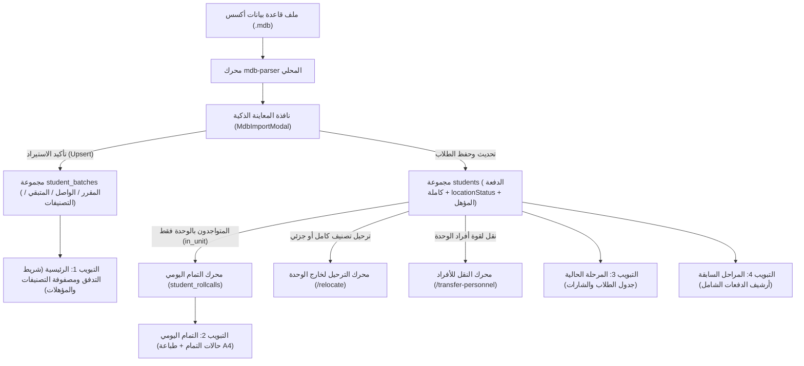

# Implementation Plan: ترقية شئون الطلاب واستخراج ملفات MDB (المرحلة الأولى)
## دورة حياة الدفعة، مصفوفة التصنيفات، ومحرك الترحيل والنقل

**Branch**: `011-students-mdb-upgrade` | **Date**: 2026-11-05 (Updated) | **Spec**: [spec.md](./spec.md)  
**Input**: Feature specification from `specs/011-students-mdb-upgrade/spec.md` (PRD الإصدار 2.3)

---

## Summary

تنفيذ ترقية معمارية وتشغيلية شاملة لموديول شئون الطلاب والدارسين (`/students`):
1. **دورة تدفق وصول الدفعة**: تتبع ثلاثي للقوة (المقرر وصوله، ما تم وصوله، المتبقي للوصول) مع بقاء الدفعة مسجلة كاملة معاً في مرحلتها.
2. **منظومة التصنيفات التخصصية والمؤهلات**: تقسيم الدفعة لتصنيفات قابلة للتخصيص الكامل (`صف إشارة`، `تد مهني`، `إشارة ق. ج`، `إشارة تد مهني ق. ج` مع دعم الإضافة والتعديل والحذف)، وتفريع المؤهلات الأربعة تحت كل تصنيف (`عليا`، `فوق متوسطة`، `متوسطة`، `عادة`).
3. **محرك الترحيل والنقل (تعديل مبدأ الشطب)**: ترحيل تصنيف كامل أو جزئي لخارج الوحدة، أو نقل أفراد لقوة الوحدة الدائمة، مع بقاء كافة الجنود مسجلين بالدفعة وتمييز الموقع (`locationStatus: in_unit | relocated | transferred_to_unit_personnel`).
4. **محرك استخراج ملفات Access (`.mdb`)**: استخراج سريع لجدول `src_soldiers` و `gyabhabs` مع المعاينة الذكية والتحديث بنظام `Upsert`.
5. **محرك التمام اليومي الميداني**: حصر التمام حصرياً على الجنود المتواجدين بالوحدة (`in_unit`) وفق الحالات الـ 13 المعتمدة والإغلاق عند 06:00 صباحاً.
6. **واجهة التبويبات القياسية (`FolderTabs`)**:
   - **الرئيسية**: شريط تدفق وصول الدفعة السداسي ومصفوفة التصنيفات والمؤهلات التفاعلية.
   - **التمام اليومي**: جدول وقوة التمام اليومي للمتواجدين بالوحدة مع نموذج طباعة معتمد.
   - **المرحلة الحالية**: جدول طلاب المرحلة بالاسم الديناميكي وأعمدة التصنيف والموقع.
   - **المراحل السابقة**: أرشيف الدفعات الشامل وفلاتر الجنود المتبقين.

---

## Technical Context

- **Language/Version**: TypeScript 5.9.3 (Strict Mode — حظر تام لأي استخدام لـ `any`)
- **Primary Dependencies**: Next.js 16.4.3 (App Router, React 19, Server Components), Mongoose 9.6.2, Tailwind CSS 4, Lucide React, Zod 4, react-to-print
- **Storage**: MongoDB 7 محلي عبر Docker + تخزين ملفات محلي في `public/uploads/`
- **System Utilities**: `mdbtools` (`/usr/bin/mdb-export`, `/usr/bin/mdb-tables`)
- **Testing**: TypeScript Typecheck (`npx tsc --noEmit`), ESLint, Manual Workflow & Independent Test Cases
- **Design System SSOT**: هوية Sapphire Archive القياسية، `MainTable`، `ModalShell` بدون backdrop blur، `CustomSelect`، `DateField`، الرموز اللونية (`--color-primary`, `--app-muted-foreground`).

---

## Architecture & Implementation Phases

### المرحلة 1: أساس البيانات ونماذج التدفق والتصنيفات (Foundations & Schema Upgrade)
- إنشاء موديل `StudentBatch.ts` و `StudentBatch.shared.ts` بحقول التدفق (`targetCount`, `arrivedCount`, `remainingCount`) والتصنيفات المعتمدة.
- ترقية موديل `Student.ts` و `Student.shared.ts` بإضافة `classificationId`، `classificationName`، وتعديل حقل الموقع `locationStatus: 'in_unit' | 'relocated' | 'transferred_to_unit_personnel'`، وتوسيع كائنات `relocationDetails` و `unitPersonnelDetails`.
- تعديل موديل `StudentRollcall.ts` ليعتمد قصر القوة على المتواجدين بالوحدة (`in_unit`) فقط.
- تحديث مخططات Zod في `next/lib/validations/student.ts` لدعم حركات الترحيل والنقل وتعديل المقرر والتصنيفات.

### المرحلة 2: محرك الـ API وإدارة الدفعة وحركات الترحيل والنقل
- إنشاء مسار `POST /api/students/relocate` للترحيل الجماعي لتصنيف كامل أو ترحيل أفراد محددين مع توثيق جهة وأمر الترحيل.
- إنشاء مسار `POST /api/students/transfer-personnel` لنقل أفراد لقوة الوحدة الدائمة.
- إنشاء مسار `PATCH /api/students/stages/[id]/target` لتحديث المقرر وصوله، ومسارات إدارة التصنيفات `classifications`.
- تحديث مسار `GET /api/students/stages` ليعيد إحصائيات التدفق الثلاثية والتصنيفات التخصصية.
- تحديث مسار `GET /api/students/rollcall` ليقتصر على استدعاء طلاب `locationStatus === "in_unit"`.

### المرحلة 3: تطوير وتحديث واجهات المستخدم (UI Components & Tabs)
- **لوحة المؤشرات (Dashboard Tab):** إضافة شريط تدفق وصول الدفعة (المقرر، الواصل، المتبقي، المتواجد بالوحدة، المرحل، المنتقل للأفراد)، وبناء مصفوفة التصنيفات والمؤهلات التفاعلية (Matrix Panel).
- **المرحلة الحالية (Current Stage Tab):** إضافة شريط إحصائيات التدفق وتحديث جدول الطلاب بـ `MainTable` لعرض عامود التصنيف التخصصي وشارات الموقع الثلاث، وزر إدارة التصنيفات.
- **نافذة ترحيل التصنيفات لخارج الوحدة (`StudentRelocationModal.tsx`):** اختيار تصنيف كامل أو أفراد محددين، وتوثيق جهة وتاريخ وأمر الترحيل.
- **نافذة النقل لقوة الأفراد (`StudentPersonnelTransferModal.tsx`):** توثيق أمر التسكين والوظيفة بالوحدة.
- **التمام اليومي (`StudentRollcallTab.tsx`):** التأكيد على قصر القائمة على المتواجدين بالوحدة وضبط مؤشرات الحضور والخوارج.
- **المراحل السابقة (`PreviousStagesTab.tsx`):** عرض الدفعات السابقة مع أعمدة التصنيف والموقع وحالة التسريح.

### المرحلة 4: التدقيق الشامل وضمان الجودة الصارمة
- فحص TypeScript بنمط صارم (`npx tsc --noEmit`) وضمان 0 أخطاء.
- مراجعة استجابة مصفوفة التصنيفات ونوافذ الترحيل والنقل.
- التحقق من عدم ظهور أي جندي مرحل أو منقول للأفراد في تمام اليوم.
