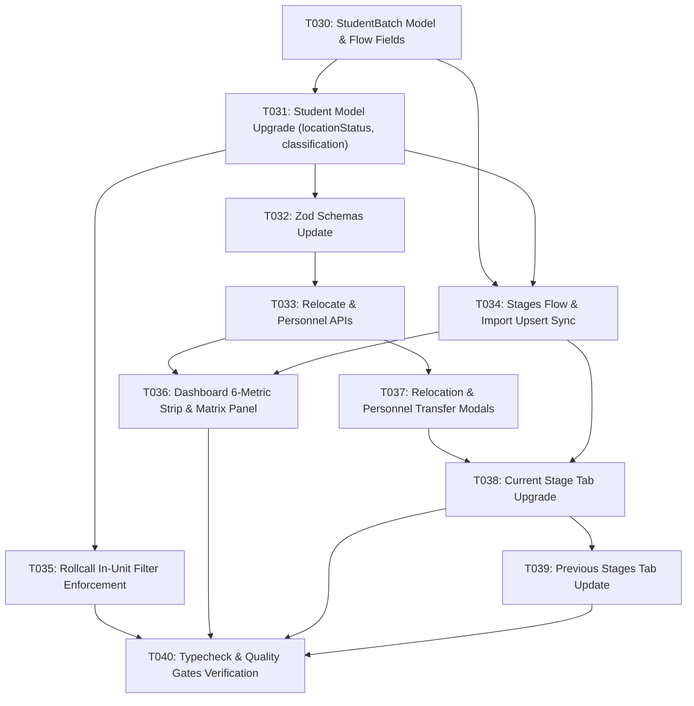

# Tasks: ترقية منظومة شئون الطلاب واستخراج ملفات Access (.mdb)
## دورة حياة الدفعة، مصفوفة التصنيفات، ومحرك الترحيل والنقل

**Input**: Design documents from `/specs/011-students-mdb-upgrade/`  
**Prerequisites**: `plan.md`, `spec.md`, `data-model.md`, `contracts/api-contracts.md`  
**Status**: Phases 1-10 Completed (100%)

---

## Phase 1: Setup (Shared Infrastructure & Types)
- [x] T001 [P] Create centralized shared student types in `next/lib/db/models/Student.shared.ts`
- [x] T002 [P] Create centralized shared rollcall types in `next/lib/db/models/StudentRollcall.shared.ts`
- [x] T003 Upgrade Mongoose Student model in `next/lib/db/models/Student.ts`
- [x] T004 Create Mongoose StudentRollcall model in `next/lib/db/models/StudentRollcall.ts`
- [x] T005 Export new models and types centrally in `next/lib/db/models/index.ts` and `next/types/index.ts`

---

## Phase 2: Foundational (MDB Parser Utility & RBAC Helpers)
- [x] T006 Implement MDB parser service in `next/lib/students/mdb-parser.ts` using `/usr/bin/mdb-export`
- [x] T007 [P] Create student Zod validation schemas in `next/lib/validations/student.ts`
- [x] T008 [P] Add student active stage system settings helper in `next/lib/students/settings.ts`

---

## Phase 3: User Story 1 - استيراد بيانات الطلبة من ملف Access مع المعاينة قبل الحفظ (P1)
- [x] T009 [US1] Create API route `next/app/api/students/upload-mdb/route.ts`
- [x] T010 [US1] Create API route `next/app/api/students/import-confirm/route.ts`
- [x] T011 [US1] Build MDB upload & preview modal component in `next/components/students/MdbImportModal.tsx`

---

## Phase 4: User Story 3 - المرحلة الحالية النشطة وجدول طلابها (P1)
- [x] T012 [P] [US3] Create API route `next/app/api/students/stages/route.ts`
- [x] T013 [P] [US3] Create API route `next/app/api/students/active-stage/route.ts`
- [x] T014 [US3] Build stage switcher dropdown component in `next/components/students/StageSelector.tsx`
- [x] T015 [US3] Build current stage students table component in `next/components/students/CurrentStageTab.tsx`

---

## Phase 5: User Story 2 - التمام اليومي لطلبة المرحلة الحالية (P1)
- [x] T016 [US2] Create API route `next/app/api/students/rollcall/route.ts`
- [x] T017 [US2] Build student daily rollcall tab component in `next/components/students/StudentRollcallTab.tsx`
- [x] T018 [US2] Build official printable A4 rollcall military sheet component in `next/components/students/StudentRollcallPrint.tsx`

---

## Phase 6: User Story 4 - الشطب والضم لقوة الأفراد وإلغاؤه (P1 - Legacy)
- [x] T019 [US4] Create API route `next/app/api/students/[id]/shatb/route.ts`
- [x] T020 [US4] Create API route `next/app/api/students/[id]/shatb-reverse/route.ts`
- [x] T021 [US4] Build strikethrough action dialogs in `next/components/students/StudentShatbModal.tsx`

---

## Phase 7: User Story 5 - لوحة المؤشرات والتوزيعات للطلبة (P2)
- [x] T022 [US5] Create students analytics service in `next/lib/students/analytics.ts`
- [x] T023 [US5] Build students dashboard tab component in `next/components/students/StudentsDashboardTab.tsx`

---

## Phase 8: User Story 6 - أرشيف المراحل السابقة (P2)
- [x] T024 [US6] Create API route `next/app/api/students/distribution-status/route.ts`
- [x] T025 [US6] Build previous stages archive component in `next/components/students/PreviousStagesTab.tsx`

---

## Phase 9: Polish & Full Integration
- [x] T026 Assemble all tabs into `FolderTabs` on the main page `next/app/(dashboard)/students/page.tsx`
- [x] T027 [P] Update navigation and breadcrumb links for `/students`
- [x] T028 Run strict typecheck `npx tsc --noEmit`
- [x] T029 Perform UI audit against `/theme-playground`

---

## Phase 10: Delta Upgrade - دورة حياة الدفعة، مصفوفة التصنيفات، ومحرك الترحيل والنقل (Current Active Phase)

**Purpose**: تنفيذ وتطبيق التعديل الجوهري المعتمد في PRD 2.3 للدفعة وحركات الترحيل والنقل وتفصيل المؤهلات.

- [x] T030 [Delta/Setup] Create `StudentBatch.shared.ts` and `StudentBatch.ts` Mongoose model in `next/lib/db/models/` for tracking arrival flow (`targetCount`, `arrivedCount`, `remainingCount`) and customizable classifications (`IBatchClassification`), re-exported in `@/lib/db/models` and `@/types/`.
- [x] T031 [Delta/Setup] Upgrade `next/lib/db/models/Student.shared.ts` and `next/lib/db/models/Student.ts` with `classificationId`, `classificationName`, `qualification` (`high` | `above_avg` | `average` | `normal`), and `locationStatus` (`in_unit` | `relocated` | `transferred_to_unit_personnel`), `relocationDetails`, and `unitPersonnelDetails`.
- [x] T032 [Delta/Validation] Update Zod schemas in `next/lib/validations/student.ts` for relocation (`relocateSchema`), transfer to personnel (`transferPersonnelSchema`), batch target update, and classification management.
- [x] T033 [Delta/API] Create API routes:
  - `POST /api/students/relocate` supporting whole classification or selected soldiers relocation outside unit with audit logging.
  - `POST /api/students/transfer-personnel` supporting transfer to unit personnel strength with audit logging.
  - `PATCH /api/students/stages/[id]/target` for batch target count updates.
- [x] T034 [Delta/API] Update `next/app/api/students/stages/route.ts` and `next/app/api/students/import-confirm/route.ts` to compute and return batch arrival flow (`targetCount`, `arrivedCount`, `remainingCount`, `inUnitCount`, `relocatedCount`, `transferredPersonnelCount`) and sync default classifications.
- [x] T035 [Delta/API] Update `next/app/api/students/rollcall/route.ts` to strictly query only students with `locationStatus: "in_unit"` so relocated and personnel-transferred soldiers are automatically excluded from daily rollcall calculations.
- [x] T036 [Delta/UI] Upgrade `next/components/students/StudentsDashboardTab.tsx` with the 6-metric batch flow strip (المقرر، الواصل، المتبقي، المتواجد بالوحدة، المرحل، المنتقل للأفراد) and the interactive Classification & Qualification Matrix Panel (`OperateDistributionPanel`).
- [x] T037 [Delta/UI] Build relocation modal `next/components/students/StudentRelocationModal.tsx` and personnel transfer modal `next/components/students/StudentPersonnelTransferModal.tsx` using `ModalShell` and Sapphire Archive design tokens.
- [x] T038 [Delta/UI] Upgrade `next/components/students/CurrentStageTab.tsx` with batch flow header counters, customizable classification filter, qualification filter, location status badges (`لا زال بالوحدة`, `تم ترحيله`, `انتقل للأفراد`), and integrate relocation & personnel transfer action modals.
- [x] T039 [Delta/UI] Update `next/components/students/PreviousStagesTab.tsx` to display location status and classification for archived batches.
- [x] T040 [Delta/Verification] Run strict typecheck `npx tsc --noEmit` with zero errors, verify zero UI regressions, and ensure complete audit logging.

---

## Dependencies & Execution Flow (Phase 10)

