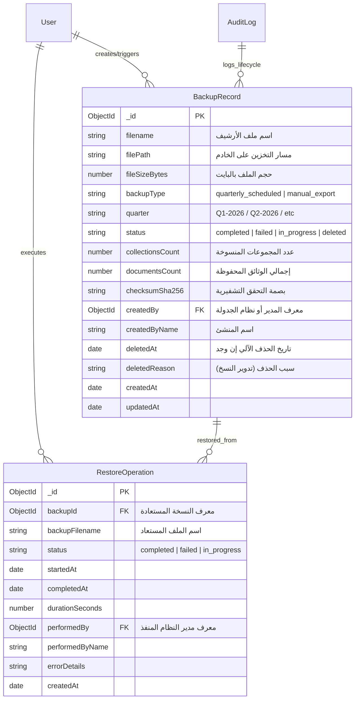
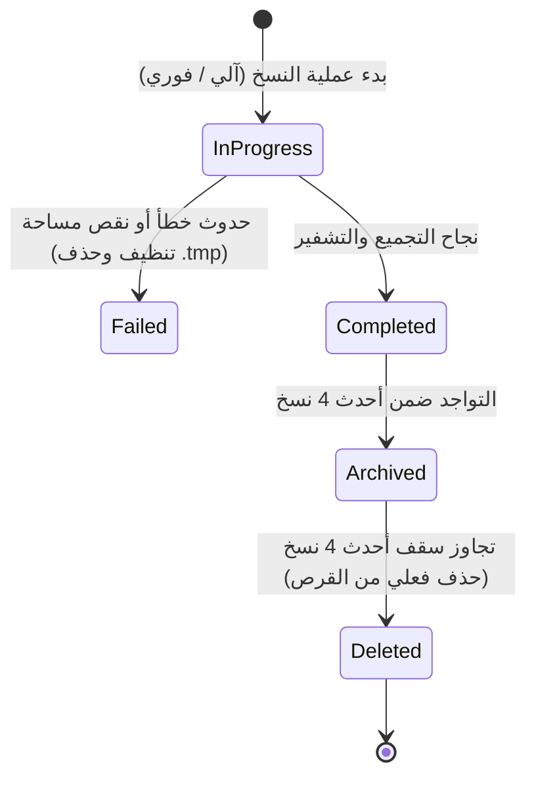

# Data Model: سياسة وحوكمة النسخ الاحتياطي الربع سنوي وتدوير النسخ

**Feature**: `012-quarterly-backup-retention`  
**Date**: 2026-11-04  

---

## 1. الكيانات وعلاقات البيانات (Data Entities & Relations)



---

## 2. تعريف نماذج Mongoose ومخططات TypeScript

### نموذج سجل النسخة الاحتياطية (`BackupRecord.ts`)
**المسار:** `next/lib/db/models/BackupRecord.ts`

```typescript
import mongoose, { Schema, Document, Types } from "mongoose";

export type BackupType = "quarterly_scheduled" | "manual_export";
export type BackupStatus = "in_progress" | "completed" | "failed" | "deleted";

export interface IBackupRecord extends Document {
  filename: string;
  filePath: string;
  fileSizeBytes: number;
  backupType: BackupType;
  quarter?: string; // e.g. "Q1-2026"
  status: BackupStatus;
  collectionsCount: number;
  documentsCount: number;
  checksumSha256?: string;
  createdBy: Types.ObjectId;
  createdByName: string;
  deletedAt?: Date;
  deletedReason?: string;
  createdAt: Date;
  updatedAt: Date;
}

const BackupRecordSchema = new Schema<IBackupRecord>(
  {
    filename: { type: String, required: true, unique: true, index: true },
    filePath: { type: String, required: true },
    fileSizeBytes: { type: Number, required: true, default: 0 },
    backupType: {
      type: String,
      enum: ["quarterly_scheduled", "manual_export"],
      required: true,
      index: true,
    },
    quarter: { type: String, trim: true },
    status: {
      type: String,
      enum: ["in_progress", "completed", "failed", "deleted"],
      default: "in_progress",
      index: true,
    },
    collectionsCount: { type: Number, default: 0 },
    documentsCount: { type: Number, default: 0 },
    checksumSha256: { type: String },
    createdBy: { type: Schema.Types.ObjectId, ref: "User", required: true },
    createdByName: { type: String, required: true },
    deletedAt: { type: Date },
    deletedReason: { type: String },
  },
  {
    timestamps: true,
  }
);

BackupRecordSchema.index({ createdAt: -1 });
BackupRecordSchema.index({ status: 1, createdAt: -1 });

export const BackupRecord =
  mongoose.models.BackupRecord ||
  mongoose.model<IBackupRecord>("BackupRecord", BackupRecordSchema);
```

---

### نموذج سجل الاستعادة (`RestoreOperation.ts`)
**المسار:** `next/lib/db/models/RestoreOperation.ts`

```typescript
import mongoose, { Schema, Document, Types } from "mongoose";

export type RestoreStatus = "in_progress" | "completed" | "failed";

export interface IRestoreOperation extends Document {
  backupId: Types.ObjectId;
  backupFilename: string;
  status: RestoreStatus;
  startedAt: Date;
  completedAt?: Date;
  durationSeconds?: number;
  performedBy: Types.ObjectId;
  performedByName: string;
  errorDetails?: string;
  createdAt: Date;
}

const RestoreOperationSchema = new Schema<IRestoreOperation>(
  {
    backupId: { type: Schema.Types.ObjectId, ref: "BackupRecord", required: true },
    backupFilename: { type: String, required: true },
    status: {
      type: String,
      enum: ["in_progress", "completed", "failed"],
      default: "in_progress",
    },
    startedAt: { type: Date, required: true, default: Date.now },
    completedAt: { type: Date },
    durationSeconds: { type: Number },
    performedBy: { type: Schema.Types.ObjectId, ref: "User", required: true },
    performedByName: { type: String, required: true },
    errorDetails: { type: String },
  },
  {
    timestamps: { createdAt: true, updatedAt: false },
  }
);

export const RestoreOperation =
  mongoose.models.RestoreOperation ||
  mongoose.model<IRestoreOperation>("RestoreOperation", RestoreOperationSchema);
```

---

## 3. دورة حياة النسخة وتدوير النسخ (State Transition & Lifecycle)



---

## 4. قواعد التحقق وقفل العمليات (Validation Rules & Concurrency)

1. **قفل التنفيذ الأحادي (Concurrency Mutex):**
   - متغير قفل تنفيذي في الذاكرة `isBackupOrRestoreRunning: boolean`.
   - يمنع تشغيل أي عملية نسخ أو استعادة في حال وجود عملية أخرى جارية ويرجع كود `409 Conflict`.
2. **التحقق من سلامة البصمة (SHA-256 Checksum):**
   - عند إنشاء الأرشيف، يتم توليد بصمة SHA-256 وحفظها في `manifest.json` وسجل `BackupRecord`.
   - عند الاستعادة، يتم فحص البصمة؛ وإذا حدث أي اختلاف يُرفض الاسترجاع فوراً لمنع تطبيق ملفات تالفة أو معدلة.
3. **التحقق من كلمة المرور المزدوجة والتأكيد الكتابي:**
   - مخطط Zod يتحقق من إرسال كلمة مرور المدير الحالية وعبارة التأكيد الدقيقة `"استعادة النسخة الاحتياطية"`.
