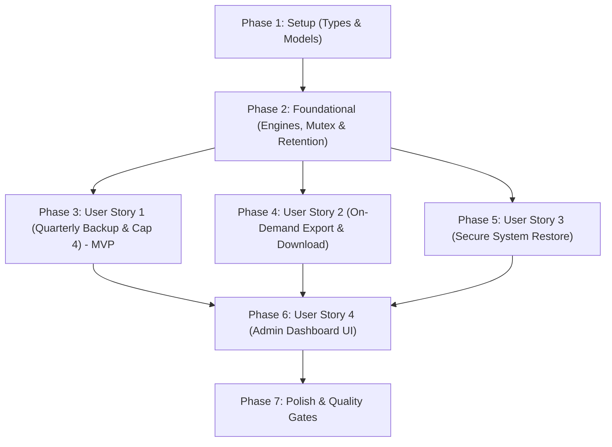

# Tasks: سياسة وحوكمة النسخ الاحتياطي الربع سنوي وتدوير النسخ (المرحلة الثانية)

**Input**: Design documents from `/specs/012-quarterly-backup-retention/`  
**Prerequisites**: `plan.md`, `spec.md`, `research.md`, `data-model.md`, `contracts/backup-api.md`, `quickstart.md`  
**Organization**: Tasks are grouped by user story to enable independent implementation and testing of each story.  

## Format: `[ID] [P?] [Story] Description`
- **[P]**: Can run in parallel (different files, no dependencies)
- **[Story]**: Which user story this task belongs to (`[US1]`, `[US2]`, `[US3]`, `[US4]`)
- All paths are exact and project-relative under `next/`

---

## Phase 1: Setup (Shared Infrastructure & Types)

**Purpose**: Initializing core types, models, and shared system schemas for backup management.

- [x] T001 [P] Create centralized shared backup types in `next/types/backup.ts` (BackupType, BackupStatus, RestoreStatus, IBackupRecord, IRestoreOperation, IStorageStats)
- [x] T002 [P] Create Mongoose BackupRecord model in `next/lib/db/models/BackupRecord.ts` with compound indexes on `{ createdAt: -1 }` and `{ status: 1, createdAt: -1 }`
- [x] T003 [P] Create Mongoose RestoreOperation model in `next/lib/db/models/RestoreOperation.ts`
- [x] T004 Export new backup models and types centrally in `next/lib/db/models/index.ts` and `next/types/index.ts`

---

## Phase 2: Foundational (Core Engines: Disk Space, Streaming Dump, Concurrency Lock, Retention)

**Purpose**: Core offline backup and restore utilities, disk space inspection, and concurrency safety.

- [x] T005 [P] Implement disk space inspection utility in `next/lib/backup/disk-space.ts` using Node.js `fs.promises.statfs` with 20% free space and 2x size safety thresholds
- [x] T006 Implement concurrency execution lock (Mutex) in `next/lib/backup/mutex-lock.ts` to prevent parallel backup or restore runs
- [x] T007 Implement retention manager in `next/lib/backup/retention-manager.ts` enforcing the strict 4-version cap, unlinking older files via `fs.promises.unlink`, updating DB status to `deleted`, and logging to `AuditLog`
- [x] T008 [P] Create backup Zod validation schemas in `next/lib/validations/backup.ts` for export, quarterly backup, download, and restore password confirmation

---

## Phase 3: User Story 1 - النسخ الاحتياطي الآلي الربع سنوي وتدوير النسخ (Priority: P1) 🎯 MVP

**Goal**: جدولة وتنفيذ نسخ احتياطي شامل وتلقائي في نهاية كل ربع سنة (31 مارس، 30 يونيو، 30 سبتمبر، 31 ديسمبر) تشمل قاعدة البيانات وكافة المرفقات في ملف `.tar.gz` مؤرخ مع تطبيق قاعدة أحدث 4 نسخ وحذف الأقدم.  
**Independent Test**: محاكاة تنفيذ نسخة ربع سنوية، التحقق من تفريغ كافة المجموعات وأرشفة المرفقات داخل ملف `.tar.gz` يحمل طابعاً زمنياً وبصمة SHA-256، والتحقق من حذف النسخة الأقدم فور تجاوز سقف الـ 4 نسخ وتوثيق الواقعة في `AuditLog`.

- [x] T009 [US1] Implement native Mongoose & uploads archive generator in `next/lib/backup/backup-engine.ts` (streaming collections to `.json.gz`, tarring `public/uploads`, writing `manifest.json` with SHA-256 checksum, and atomic cleanup on error)
- [x] T010 [US1] Create API route `next/app/api/admin/backup/quarterly/route.ts` handling scheduled quarterly execution, invoking backup engine, applying retention manager (cap 4), and logging to `AuditLog`
- [x] T011 [US1] Implement in-app periodic quarterly checker service in `next/lib/backup/quarterly-checker.ts` verifying quarter-end dates (31 March, 30 June, 30 September, 31 December) and triggering missing backups

---

## Phase 4: User Story 2 - التصدير الفوري عند الطلب والتنزيل المباشر (Priority: P1)

**Goal**: إتاحة زر لمدير النظام لتوليد نسخة فورية شاملة وتنزيلها مباشرة عبر المتصفح لوسيط تخزين خارجي، مع إدراجها ضمن سقف أحدث 4 نسخ وحفظها بأمان.  
**Independent Test**: النقر على زر "تصدير نسخة احتياطية فورية"، التحقق من بدء العملية، التحقق من المساحة الحرة، إنشاء الأرشيف، وبدء التنزيل الثنائي للملف مباشرة عبر المتصفح، والتحقق من تسجيل العملية في `AuditLog`.

- [x] T012 [US2] Create API route `next/app/api/admin/backup/route.ts` supporting `POST` (create on-demand backup with disk space pre-check, retention rotation, and audit logging) and `GET` (list active backups and storage stats)
- [x] T013 [US2] Create API route `next/app/api/admin/backup/download/[id]/route.ts` for binary streaming download of `.tar.gz` files with audit logging
- [x] T014 [US2] Create single backup delete API route in `next/app/api/admin/backup/[id]/route.ts` for manual cleanup with audit logging

---

## Phase 5: User Story 3 - استعادة النظام والبيانات من نسخة احتياطية (Priority: P1)

**Goal**: واجهة ومسار استعادة مؤمن يتيح لمدير النظام استرجاع كامل قاعدة البيانات والمرفقات من نسخة سابقة، مع اشتراط كلمة مرور المدير والعبارة التأكيدية لمنع الأخطاء.  
**Independent Test**: اختيار نسخة سابقة والضغط على "استعادة"، تجربة كلمة مرور خاطئة (تُرفض)، ثم إدخال كلمة المرور الصحيحة والعبارة التأكيدية، والتحقق من تفريغ واستبدال المجموعات واستخراج المرفقات وتوثيق العملية بالكامل في `AuditLog`.

- [x] T015 [US3] Implement atomic restore engine in `next/lib/backup/restore-engine.ts` (extracting archive, verifying manifest SHA-256 checksum, atomic collection replacement, extracting uploads, updating session state)
- [x] T016 [US3] Create API route `next/app/api/admin/backup/restore/route.ts` validating admin password via `bcryptjs.compare`, validating confirmation phrase, acquiring mutex lock, executing restore engine, and logging to `AuditLog`
- [x] T017 [US3] Build restore confirmation modal component in `next/components/admin/backup/RestoreModal.tsx` using `ModalShell`, password input with primary focus ring, warning badge, and destructive confirmation button (`btn-destructive`)

---

## Phase 6: User Story 4 - إدارة النسخ وسجل الرقابة وحالة وسائط التخزين (Priority: P2)

**Goal**: لوحة تحكم متكاملة لمدير النظام في `/admin/backup` تعرض شريط مساحة التخزين الحرة مع تنبيه 20%، وجدول تفاعلي بـ `MainTable` للنسخ مع أزرار التنزيل والاستعادة والحذف.  
**Independent Test**: فتح صفحة `/admin/backup` كمدير نظام، التحقق من ظهور مؤشر المساحة بدقة، ظهور النسخ في جدول `MainTable` مع تمييز اسم النسخة باللون الأساسي، تجربة التنزيل والاستعادة والحذف مع تحديث الجدول فورياً.

- [x] T018 [P] [US4] Build storage meter component in `next/components/admin/backup/StorageMeter.tsx` displaying total, used, free space percentage with visual warning indicator when free space is under 20%
- [x] T019 [P] [US4] Build backup table component in `next/components/admin/backup/BackupTable.tsx` using `MainTable` with serial numbers (`م`), primary entity styling on filename, action buttons (`ActionButton` with `btn-action-primary` for download and restore, and `btn-destructive` for delete)
- [x] T020 [US4] Build main admin backup management page in `next/app/(dashboard)/admin/backup/page.tsx` integrating storage meter, action buttons, backup table, and restore dialog with RTL Sapphire Archive design
- [x] T021 [US4] Add navigation link for "النسخ الاحتياطي" in Admin navigation submenus/sidebar with `DatabaseBackup` icon

---

## Phase 7: Polish & Cross-Cutting Concerns

**Purpose**: Quality gates, type safety, linting, and structural navigation indexing.

- [x] T022 Run TypeScript strict type-check (`cd next && npx tsc --noEmit`) and ensure 0 errors
- [x] T023 Run ESLint check (`cd next && npm run lint`) and clean up any unused imports or lint warnings
- [x] T024 Run `graphify auto-update .` to update the codebase structural AST navigation index

---

## Dependencies & Completion Order

---

## Parallel Execution Opportunities

- **Phase 1 (Setup)**: Tasks `T001`, `T002`, `T003` can execute in parallel.
- **Phase 2 (Foundational)**: `T005` (disk-space) and `T008` (validations) can execute in parallel with `T006` (mutex-lock) and `T007` (retention-manager).
- **Phase 6 (UI Components)**: `T018` (StorageMeter) and `T019` (BackupTable) can execute in parallel before assembling `T020` (page.tsx).

---

## Implementation Strategy & MVP

1. **MVP Scope**: Phase 1 + Phase 2 + Phase 3 (User Story 1: تفريغ قاعدة البيانات والمرفقات محلياً وتطبيق سقف أحدث 4 نسخ آلياً).
2. **Increment 2**: Phase 4 (User Story 2: التصدير الفوري عند الطلب والتنزيل المباشر لوسيط خارجي).
3. **Increment 3**: Phase 5 (User Story 3: محرك الاسترجاع الذري المحمي بكلمة المرور).
4. **Increment 4**: Phase 6 + Phase 7 (User Story 4: الواجهة الكاملة في لوحة الإدارة `/admin/backup` وبوابات الجودة `tsc` و`graphify`).
